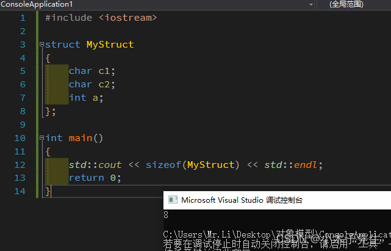
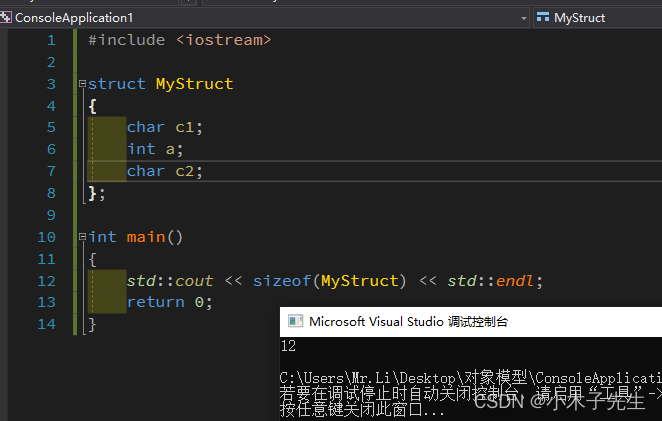
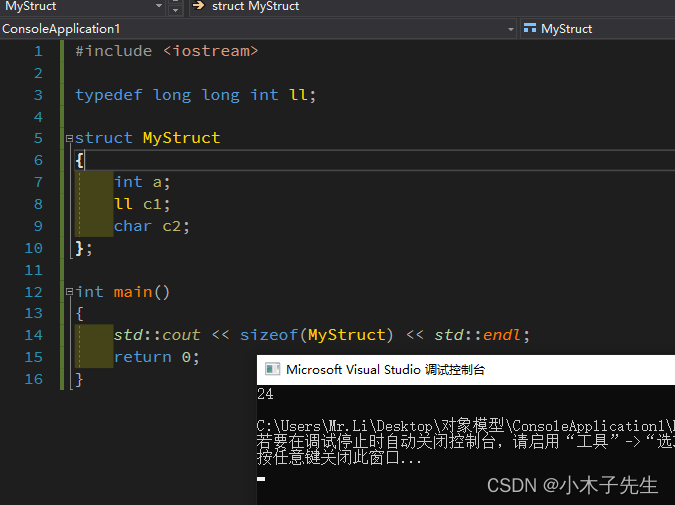
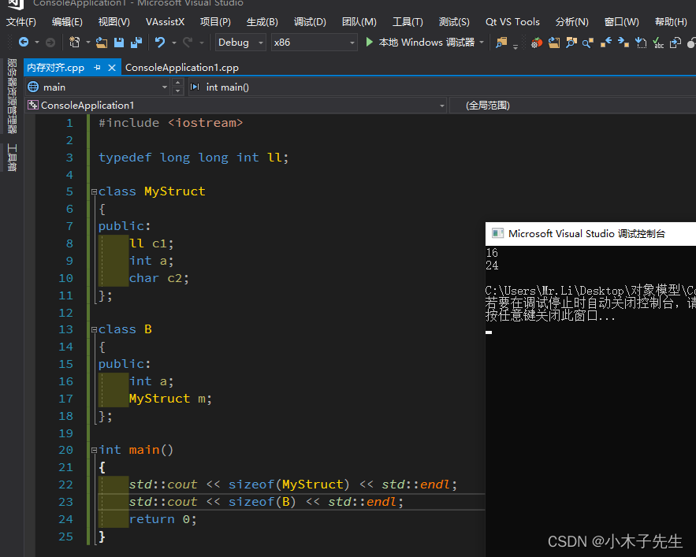
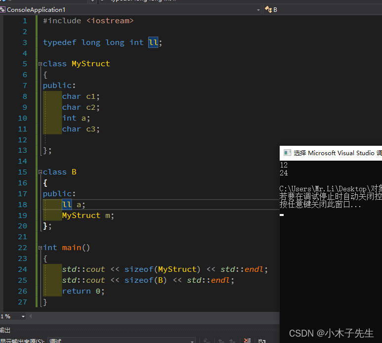
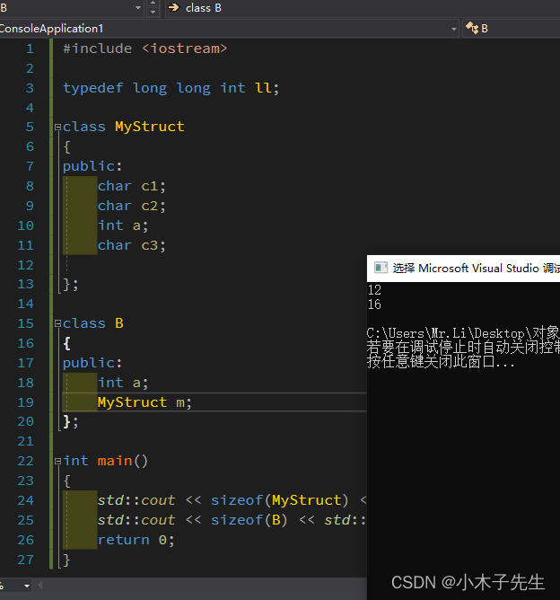

> 搬运来源：CSDN · 小木子先生（HELLO_LW）
> 原文地址：https://blog.csdn.net/HELLO_LW/article/details/131058941

# C++内存对齐

因为C++在读取内存的时候都是按4的倍数去读取的，所以就有了内存对齐

### 1. 每个变量的sizeof都小于4，就按4去补齐

看图，，该代码是占用8个字节，它是从上往下去对齐的，c1和c2占2个字节，补4个字节，a占4个字节，并不是总的算了，不足4的倍数再去补，而是从上到下补齐。

 下面我换了一个位置，就变了，现在已经很清晰了

### 2. 其中有1个或多个变量的sizeof大于4个字节

 这时就不会按4个字节去补齐了，会按最大的sizeof去补齐，看下面结果，ll的sizeof是8，就按8个字节去补齐的。

### 3. 成员类对象的补齐方式

还是按最高补齐，没有大于4的按4个补齐，不过只是基本数据类型，并不是所有类型，比如说B对象中的m占用16个字节，这里并不是按16字节去补齐，而是按8个字节去补齐的，因为m中ll为8个字节

### 疑惑

感觉上面总结的已经很到位了，但是测试的时候还是发现了一些问题，这些先留个悬念吧，后续学会了，在做更新！

