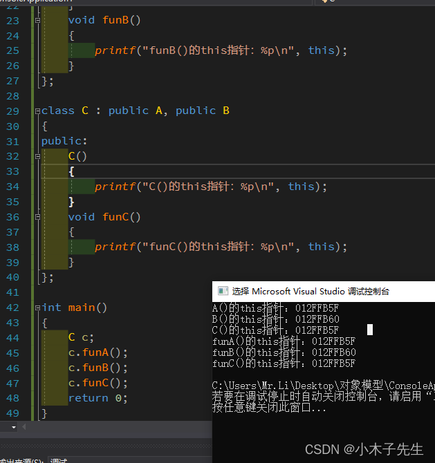
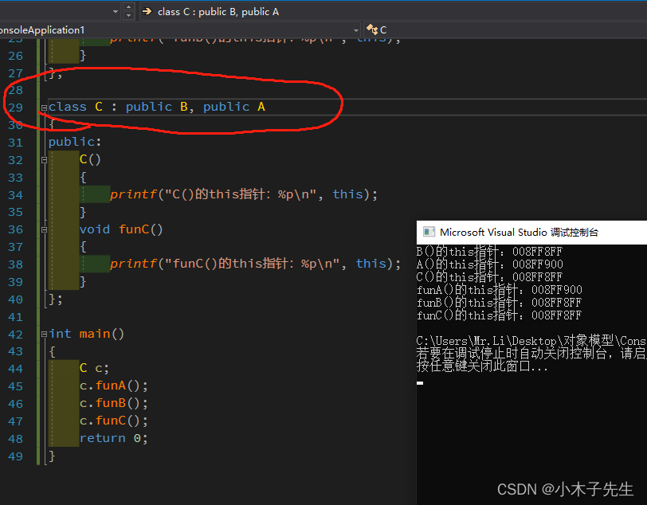

> 搬运来源：CSDN · 小木子先生（HELLO_LW）
> 原文地址：https://blog.csdn.net/HELLO_LW/article/details/131078794

# C++多继承中的this指针

## C++中多继承中的this指针

在C++继承中其中一个父类会与子类公用一个地址，本文字探索究竟公用的哪一个地址  
废话不多说，直接上代码

```cpp
#include <iostream>

class A
{
public:
	A()
	{
		printf("A()的this指针：%p\n", this);
	}
	void funA()
	{
		printf("funA()的this指针：%p\n", this);
	}
};

class B
{
public:
	B()
	{
		printf("B()的this指针：%p\n", this);
	}
	void funB()
	{
		printf("funB()的this指针：%p\n", this);
	}
};

class C : public A, public B
{
public:
	C()
	{
		printf("C()的this指针：%p\n", this);
	}
	void funC()
	{
		printf("funC()的this指针：%p\n", this);
	}
};

int main()
{
	C c;
	c.funA();
	c.funB();
	c.funC();
	return 0;
}
```

看一下运行结果  
  
可以看见对象A和C是公用的一个地址，由此我们推断多继承与第一个对象共用地址，修改顺序，再来看输出  
  
根据输出，证明了我们的猜想，共用的永远都是第一个继承对象，后面的对象在调用的时候编译器应该是会自动转换this地址的。  
这里就可以想到有虚函数多继承公用virtul table的例子，原理应该也是这样。
