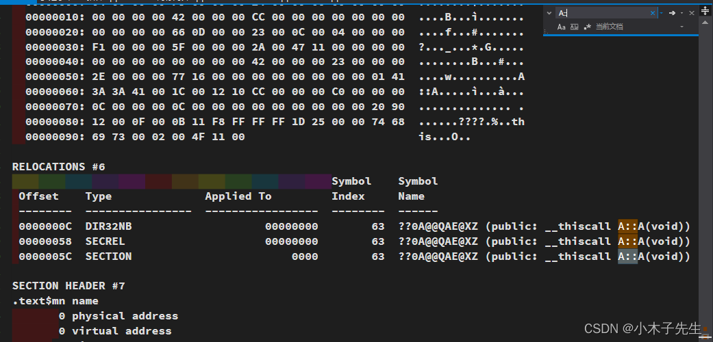
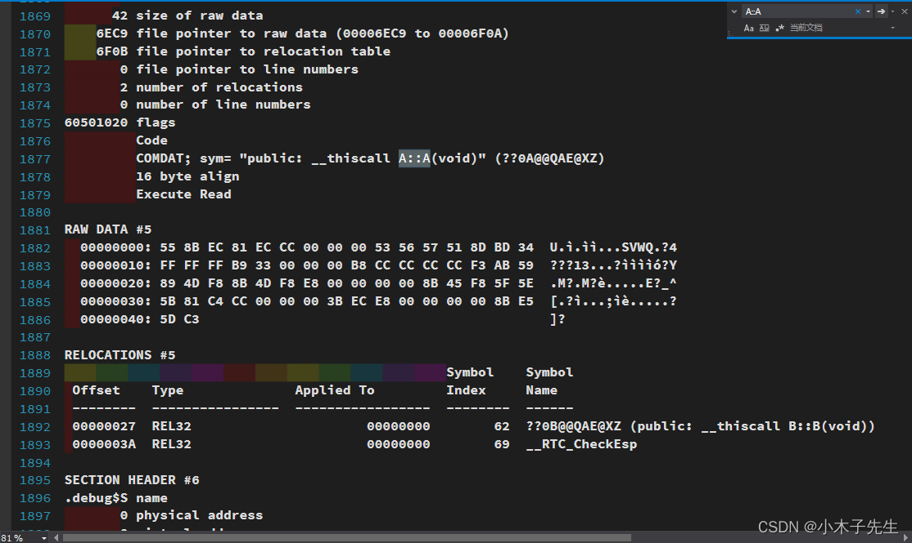
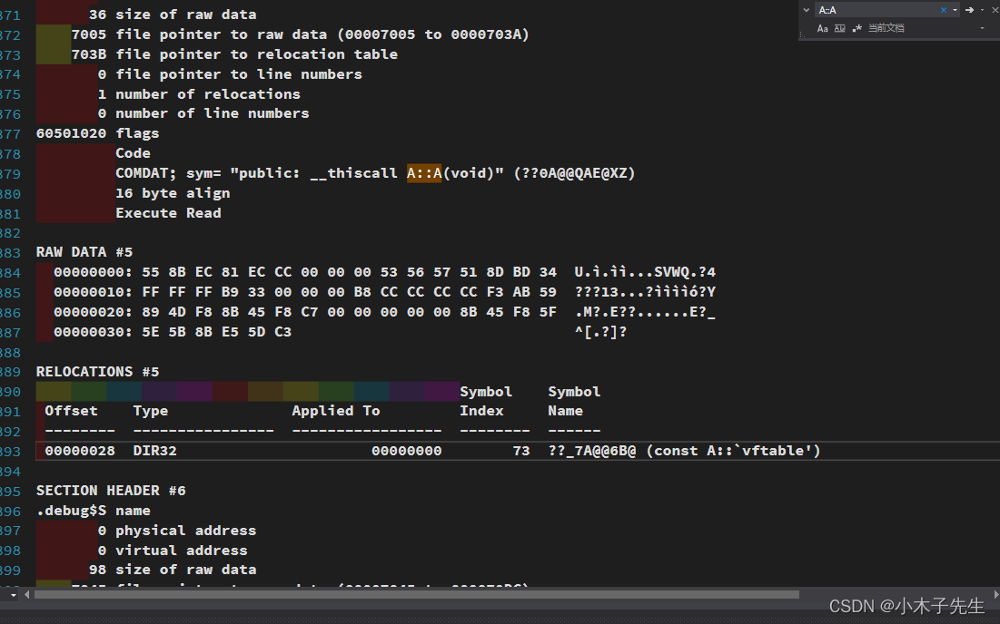
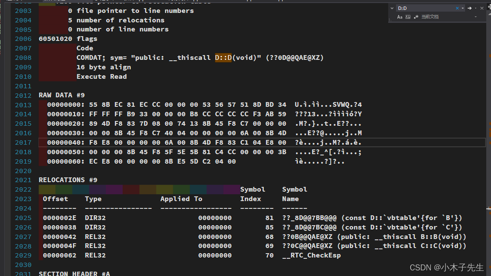

> 搬运来源：CSDN · 小木子先生（HELLO_LW）
> 原文地址：https://blog.csdn.net/HELLO_LW/article/details/131098748

# C++自动生成默认构造

## C++自动生成默认构造

之前一直知道如果一个对象如果没有写有参构造会自动生成一个无参构造。今天来探索一下.obj文件与编译器自动生成默认构造  
编译环境 win10 vs2017 x86

```cpp
class A
{
public:
	void funA(){}
};

int main()
{
	A a;
	return 0;
}
```

将这串代码生成的obj文件转换成COFF，使用VS 开发人员命令提示符

```cmd
$ dumpbin /all  XXX.obj > XXX.txt
```

就会将COFF输出到XXX.txt中去了，此时打开txt文件去搜索A::A()是没有内容的。

### 成员对象方式

下面将代码改进一下

```cpp
class B
{
public:
	B(){}
};
class A
{
public:
	void funA(){}
public:
	B b;
};

int main()
{
	A a;
	return 0;
}
```

跟上面同样的操作，去搜索  
  
很多地方都会有A::A()，所以编译器是给我自动生成了

### 继承的方式

```cpp
class B
{
public:
	B(){}
};
class A : public B
{
public:
	void funA(){}
public:
};

int main()
{
	A a;
	return 0;
}
```

现在查看OBJ文件，是有自动生成构造函数的  


### 虚函数的方式

```cpp
class A
{
public:
	virtual void funA(){}
};

int main()
{
	A a;
	return 0;
}
```

现在查看OBJ文件，是有自动生成构造函数的  
  
可以看见，还有一个vftable，这是一个虚函数表

### 菱形继承的方式

```cpp
class A
{

};

class B : virtual public A
{

};

class C : virtual public A
{

};

class D : public B, public C
{

};

int main()
{
	D d;
	return 0;
}
```

可以看见也是生成了默认构造的  
  
可以看见还生成了vbtable，这是一个虚基类表

## 总结

1. 类中含有成员对象，并且成员对象有无参构造，这时编译器会自动生成无参构造
2. 类中有继承关系，并且父类对象有无参构造，这时编译器会自动生成无参构造
3. 类中有虚函数，这时编译器会自动生成无参构造
4. 菱形继承的时候存在虚继承，这时编译器会自动生成无参构造

只有在需要调用无参构造到时候编译器才会自动生成无参构造
