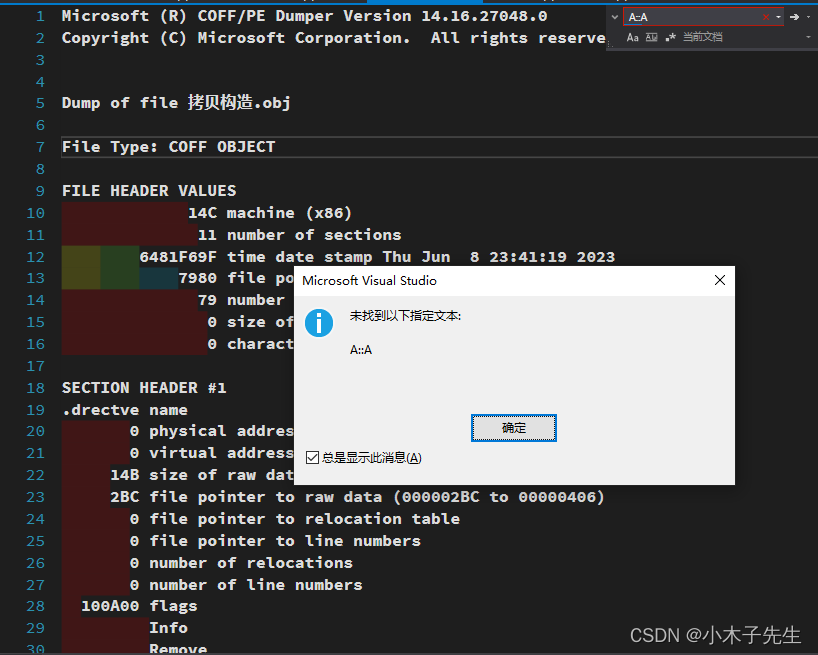
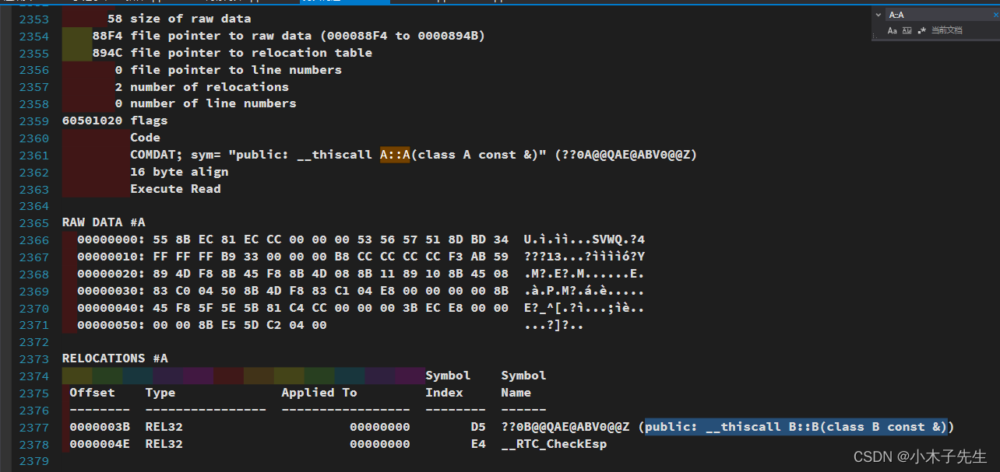
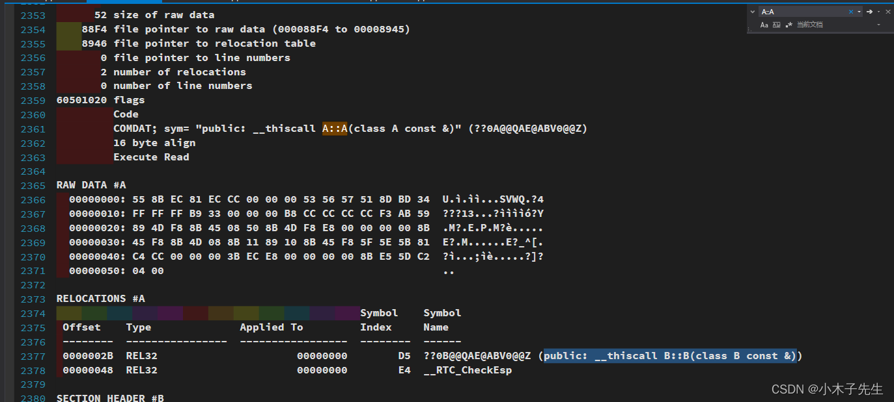
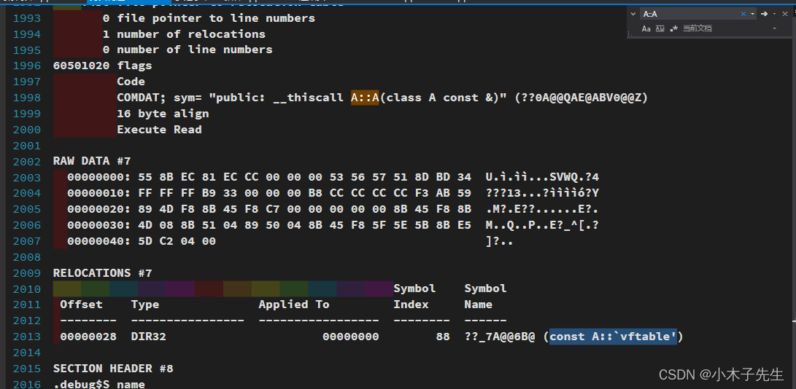
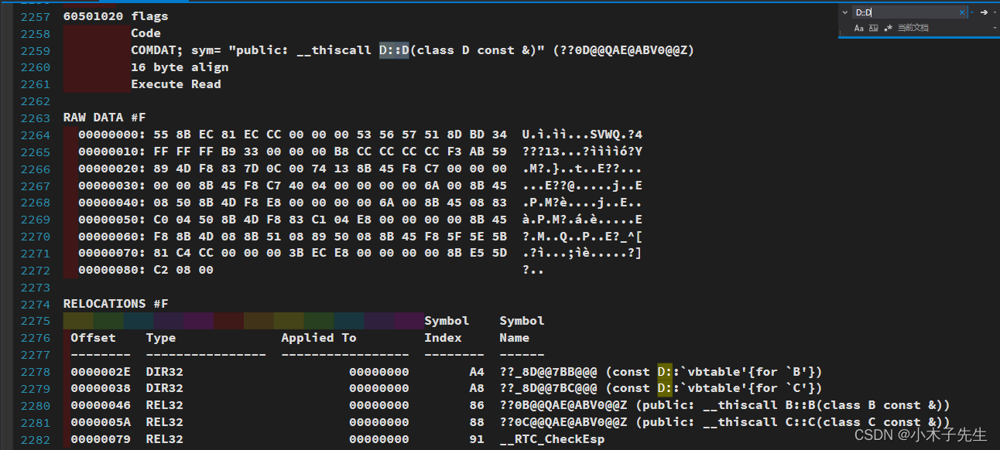

> 搬运来源：CSDN · 小木子先生（HELLO_LW）
> 原文地址：https://blog.csdn.net/HELLO_LW/article/details/131118084

# C++默认生成拷贝构造

## C++默认生成拷贝构造

编译环境：win10 vs2017 msvc2017 x86  
来探索一下C++什么时候会生成默认的拷贝构造

### 普通对象

一个没有继承关系，没有成员对象的类，是否会生成拷贝构造函数

```cpp
#include <iostream>
class A
{
public:
	int i;
};

int main()
{
	A a;
	a.i = 10;
	A a1 = a;
	std::cout << a1.i << std::endl;
	return 0;
}
```

此代码控制台会输出10，接下来看一下obj文件，并没有拷贝构造函数，但是对象a1的值却成功拷贝了，这是编译器内部的拷贝机制完成的操作，并不是拷贝构造函数完成的  


### 类中含有成员对象

类中含有成员对象，并且成员对象有拷贝构造函数

```cpp
#include <iostream>

class B
{
public:
	B(){}
	B(const B& _b)
	{
		std::cout << "B的拷贝构造" << std::endl;
	}
};

class A
{
public:
	int i;
	B b;
};

int main()
{
	A a;
	a.i = 10;
	A a1 = a;
	std::cout << a1.i << std::endl;
	return 0;
}
```

这串代码会输出：

```cpp
B的拷贝构造
10
```

下面看一下obj文件，对象A生成了一个拷贝构造函数，并且调用了父类的拷贝构造函数  


### 继承关系的类

继承关系，并且父类有拷贝构造函数

```cpp
#include <iostream>
class B
{
public:
	B(){}
	B(const B& _b)
	{
		std::cout << "B的拷贝构造" << std::endl;
	}
};

class A: public B
{
public:
	int i;
};

int main()
{
	A a;
	a.i = 10;
	A a1 = a;
	std::cout << a1.i << std::endl;
	return 0;
}
```

这串代码会输出：

```cpp
B的拷贝构造
10
```

看一下obj文件，是有拷贝构造函数的，并且调用了父类的拷贝构造函数  


### 拥有虚函数的类

```cpp
#include <iostream>
class A
{
public:
	virtual void funA(){}
public:
	int i;
};

int main()
{
	A a;
	a.i = 10;
	A a1 = a;
	std::cout << a1.i << std::endl;
	return 0;
}
```

看一下obj文件，是生成了拷贝构造，并且会拷贝虚函数表vftable  


### 虚继承

```cpp
#include <iostream>
class A
{
};

class B : virtual public A
{
};

class C : virtual public A
{
};

class D : public B, public C
{
public:
	int i;
};

int main()
{
	D a;
	a.i = 10;
	D a1 = a;
	std::cout << a1.i << std::endl;
	return 0;
}
```

看一下obj文件，生成了B、C、D的拷贝构造函数，在文件中看到构造函数还调用了虚基类表的拷贝vbtable  


## 总结

1. 当类中有成员类，并且成员类有拷贝构造函数，此时会生成该类的拷贝构造，调用成员类的拷贝构造
2. 当父类中有拷贝构造函数，此时会生成该类的拷贝构造，调用父类的拷贝构造
3. 当类中有虚函数时，此时会生成拷贝构造函数，掉用虚表拷贝vftable
4. 当使用虚继承时，此时会生成拷贝构造函数，调用虚基类表拷贝vbtable
5. 默认生成的拷贝构造并不是执行赋值操作，只会调用其它拷贝构造，赋值还是由编译器自动处理
6. 此上所有条件都必须在可以执行拷贝构造函数的代码中才生效  
   只有要调用其他拷贝构造函数的时候，编译器次啊会生成默认的拷贝构造函数
