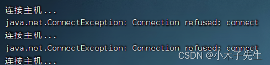
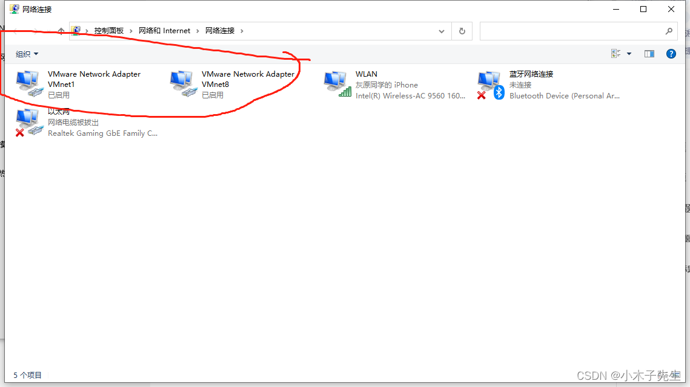
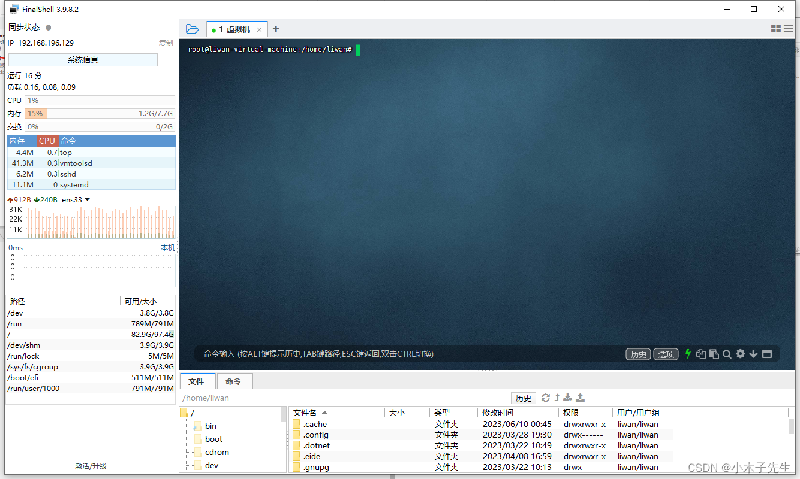

> 搬运来源：CSDN · 小木子先生（HELLO_LW）
> 原文地址：https://blog.csdn.net/HELLO_LW/article/details/131137145

# Finalshell的连接VM虚拟机问题

## Finalshell的连接VM虚拟机问题

今天使用Finalshell链接虚拟机怎么也连接不上，总是会报以下错误，于是我就开始百度：  
  
1.安装openssh  
sudo apt-get install openssh-server  
2.重启ssh服务:  
sudo service ssh restart  
3.查看是否启动:  
ps -e |grep ssh  
出现sshd 说明好了  
4.防火墙（关闭防火墙）  
（1）查看是否关闭:  
sudo ufw status  
（2）关闭防火墙  
sudo ufw disable  
（3）启动22端口（其他也行，可以设置）  
sudo ufw allow 22

原本以为成功了，结果还是不行，于是再次百度找问题！，最后发现是虚拟机网卡没有开，于是打开再次连接虚拟机就成功了！  
  
  
参考文章：  
https://blog.csdn.net/weixin_52092308/article/details/127860790?ops_request_misc=&request_id=&biz_id=102&utm_term=FinalShell%E9%93%BE%E6%8E%A5%E8%99%9A%E6%8B%9F%E6%9C%BA&utm_medium=distribute.pc_search_result.none-task-blog-2allsobaiduweb~default-3-127860790.142v88control_2,239v2insert_chatgpt&spm=1018.2226.3001.4187

https://blog.csdn.net/weixin_45939827/article/details/127895397
