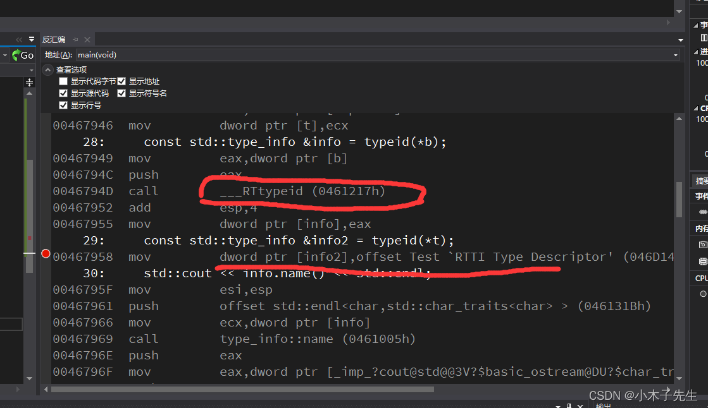
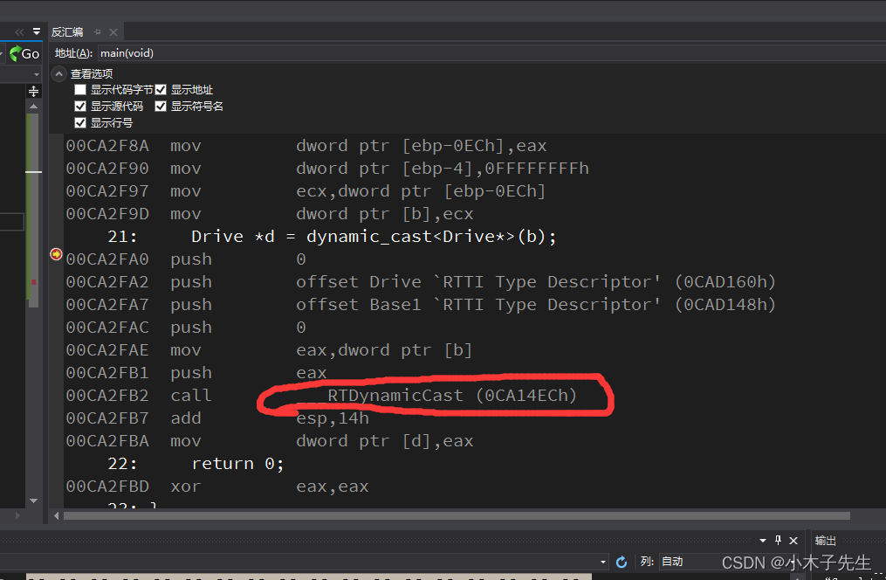
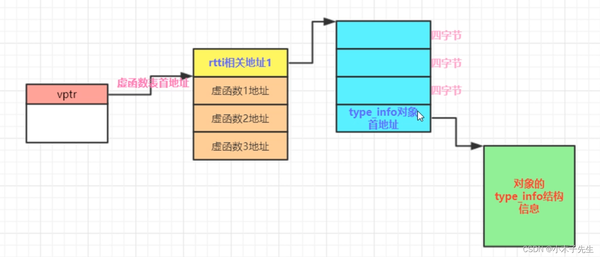

> 搬运来源：CSDN · 小木子先生（HELLO_LW）
> 原文地址：https://blog.csdn.net/HELLO_LW/article/details/131388051

# RTTI（运行时类型信息）

## 什么是RTTI，下面是来自GPT的回答

RTTI 是 “Run-Time Type Information”（运行时类型信息）的缩写。它是 C++ 提供的一种机制，用于在运行时获取和操作对象的类型信息。  
C++ 是一种静态类型语言，这意味着在编译时大部分类型信息是已知的。然而，有些情况下，我们需要在运行时动态地获取对象的类型信息，以便进行类型检查、类型转换和多态操作等。  
RTTI 提供了以下两个主要的操作：

1. typeid 运算符：typeid 运算符用于获取对象的类型信息。它返回一个 std::type_info 对象，可以通过调用其成员函数获取类型的名称和其他信息。  
   例如：

```cpp
#include <typeinfo>
...
MyClass obj;
const std::type_info& type = typeid(obj);
std::cout << "Object type: " << type.name() << std::endl;
```

2. dynamic_cast 运算符：dynamic_cast 运算符用于在多态类型之间进行安全的向下转换。它基于运行时类型信息来检查对象的类型，并返回正确类型的指针或引用。  
   例如：

```cpp
Base* basePtr = new Derived();
Derived* derivedPtr = dynamic_cast<Derived*>(basePtr);
if (derivedPtr != nullptr) {
    // 安全地将 basePtr 转换为 Derived* 类型
    ...
} else {
    // 转换失败，basePtr 并非指向 Derived 类型的对象
    ...
}
```

RTTI 是通过在对象的内存布局中添加额外的元数据信息来实现的。因此，它会增加对象的存储空间和运行时开销。在某些情况下，可以通过虚函数和多态来替代使用 RTTI，以实现更为高效的类型识别和转换机制。  
需要注意的是，使用 RTTI 可能涉及到某些运行时库的支持和编译器选项。编译器可能需要启用 RTTI 功能，以便使用 typeid 运算符和 dynamic_cast 运算符。

非常棒，不愧是AI

## RTTI何时被调用的

### 在使用typeid中

```cpp
#include <iostream>

class Base1
{
public:
	Base1(){}
	virtual ~Base1(){}
	virtual void Base1Fun(){}
};
class Drive : public Base1
{
public:
	Drive(){}
	virtual ~Drive(){}
};

class Test
{
public:
	Test(){}
	~Test(){}
};

int main()
{
	Base1 *b = new Drive();
	Test *t = new Test();
	const std::type_info &info = typeid(*b);
	const std::type_info &info2 = typeid(*t);
	std::cout << info.name() << std::endl;
	std::cout << info2.name() << std::endl;
	return 0;
}
输出：
class Drive
class Test
```

#### 汇编：



#### 分析

可以看到只有在有虚函数表的时候才会有RTTI的调用

### 在使用dynamic_cast中

```cpp
#include <iostream>

class Base1
{
public:
	Base1(){}
	virtual ~Base1(){}
	virtual void Base1Fun(){}
};
class Drive : public Base1
{
public:
	Drive(){}
	virtual ~Drive(){}
};


int main()
{
	Base1 *b = new Drive();
	Drive *d = dynamic_cast<Drive*>(b);
	return 0;
}
```

#### 汇编



#### 分析

可以看到在dynamic_cast中也调用了RTTI，但是在调用RTTI的时候都有一个共同点，那就是有虚函数表表的情况下

## RTTI内存分布

这时它的内存布局，下面我们来验证一下  


### 代码验证

```cpp
#include <iostream>
#include <cstdio>

class Base1
{
public:
	Base1(){}
	virtual ~Base1(){}
	virtual void Base1Fun(){}
};
class Drive : public Base1
{
public:
	Drive(){}
	virtual ~Drive(){}
};


int main()
{
	Base1 *b = new Drive();
	const type_info &info = typeid(*b);
	printf("%p\n", &info);
	long *vptr = (long*)b;				//获取vptr
	long *vftable = (long*)*vptr;		//获取vtable
	long *RTTIS = (long*)*(vftable - 1);//vtable地址-4个字节所指向的空间
	long *RTTI = RTTIS + 3;				//移动12个字节，type_info的地址
	long *myInfo = (long*)*RTTI;		//type_info指向的地址的值
	const type_info* info2 = (const type_info*)myInfo;	//强转一下
	printf("%p\n", info2);
	return 0;
}
输出：
00BED160
00BED160
```

验证成功！
