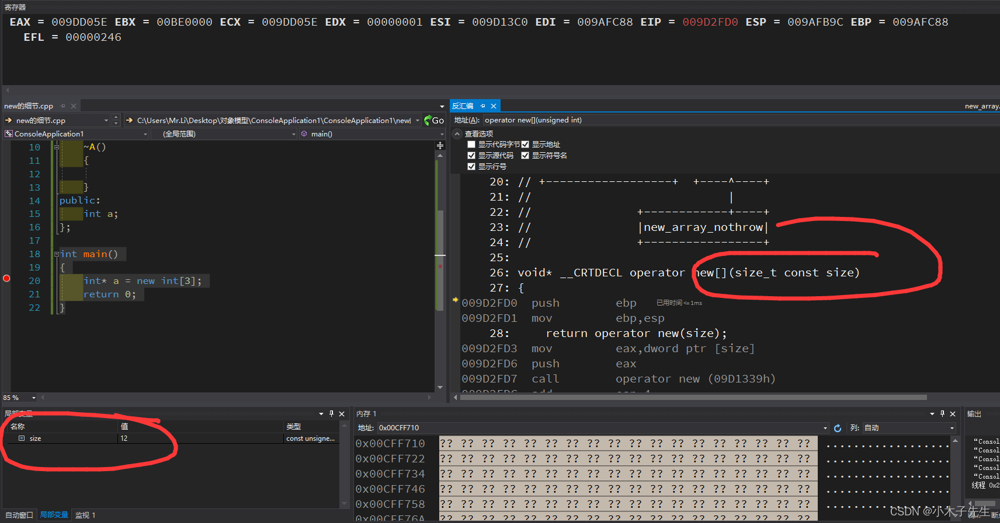
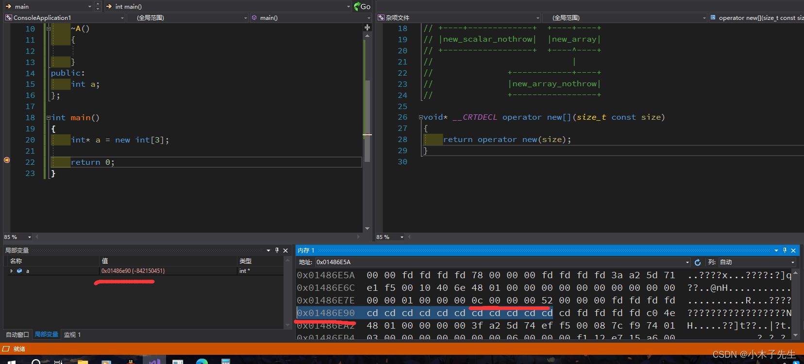
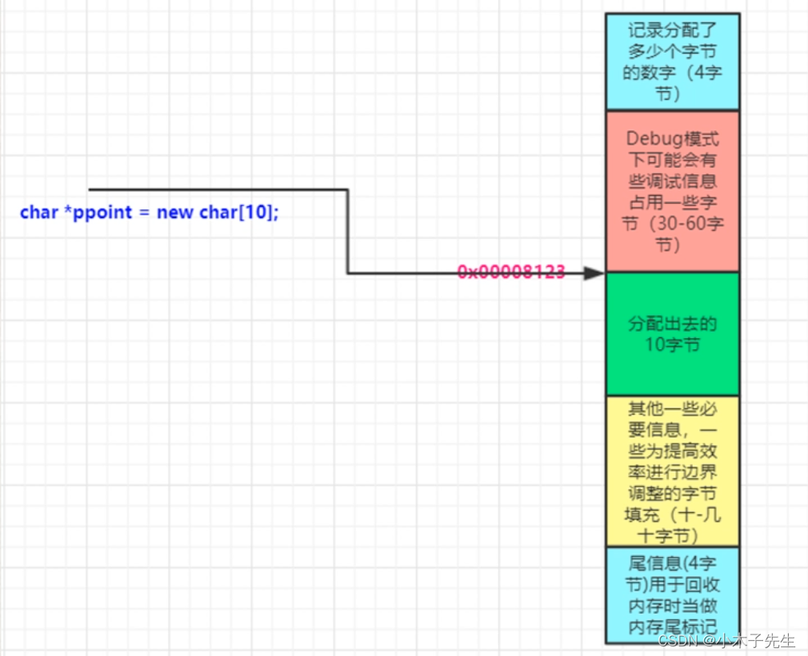
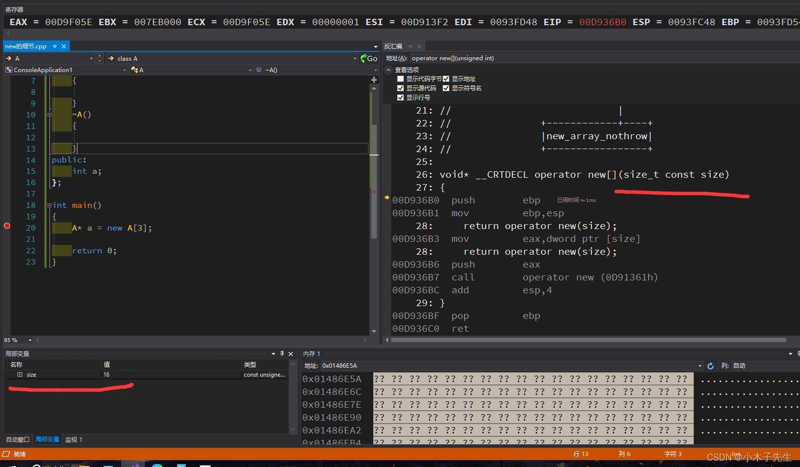
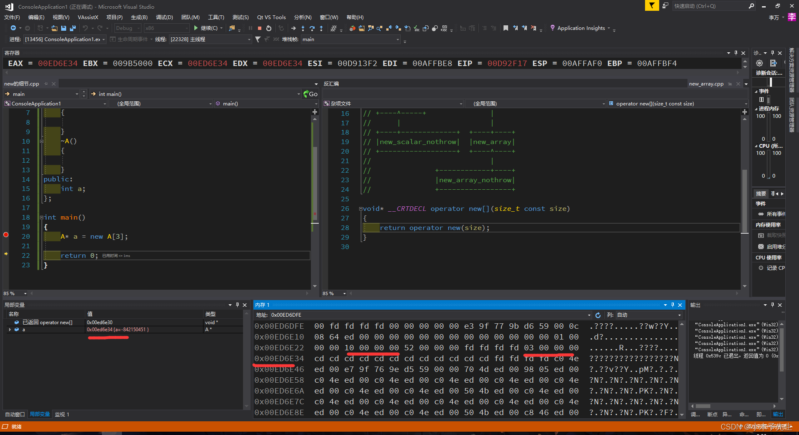
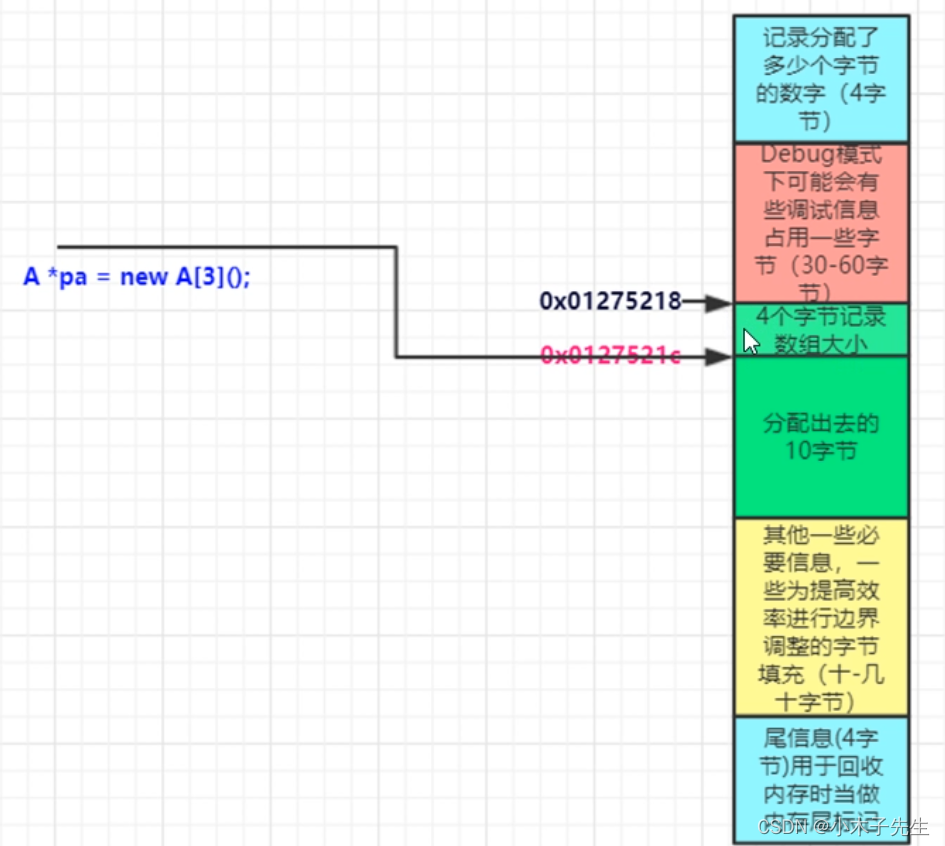

> 搬运来源：CSDN · 小木子先生（HELLO_LW）
> 原文地址：https://blog.csdn.net/HELLO_LW/article/details/131629862

# new中的细节

## new中的细节

主要论证new中做了哪些我们不知道的事情，主要使用对比论证法来论证

## new一个基本类型数组

```cpp
int main()
{
	int* a = new int[3];
	return 0;
}
```

### 汇编

通过更近汇编我们可以看到size的值是12的，3个int为12个字节，没什么问题  


### 内存

通过查看内存地址发现在a的地址之前某个位置是存储了分配了多少个字节，这里0C就是12格字节  


### 内存分布图

请忽略这张图片上面的地址，是我从网上搜的  


## new一个自定义类型数组

这里我们自定义了一个类，定义为A

```cpp
#include <iostream>

class A
{
public:
	A()
	{

	}
	~A()
	{

	}
public:
	int a;
};

int main()
{
	A* a = new A[3];

	return 0;
}
```

### 汇编

可以看见我们new的是一个对象数组，这个数组理论上应该占用12个字节，但是size却是16，说明里面多了一些东西  


### 内存地址

内存地址记录了这个类的所有信息，记录了占用16个字节，数组的个数有3个；可以发现对象数组是比基本数组多一些东西的，多了数组个数。  


### 内存分布

请忽略图片上面的地址，图片是在网上找的  

