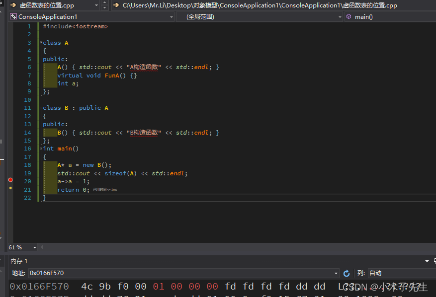

> 搬运来源：CSDN · 小木子先生（HELLO_LW）
> 原文地址：https://blog.csdn.net/HELLO_LW/article/details/131148526

# vptr在对象中的位置关系

## vptr在对象中的位置关系

如存在虚函数，那么就一定会有vptr指向vftable，vptr我们是看不见的，他的位置究竟是在对象的最前面、最后面还是在中间，来探讨一下这个问题：

### debug测试方法

```cpp
#include<iostream>

class A
{
public:
	A() { std::cout << "A构造函数" << std::endl; }
	virtual void FunA() {}
	int a;
};

class B : public A
{
public:
	B() { std::cout << "B构造函数" << std::endl; }
};
int main()
{
	A* a = new B();
	std::cout << sizeof(A) << std::endl;
	a->a = 1;
	return 0;
}
```

  
我在第20行设置了断点开始debug,先获得到了a所指向的地址，在内存中把这块地址找出来，再按下一步，发现第5-8个字节发生了改变，变成了1，所以我断定vptr是存放在对象的最前面的

### 地址判断法

将a的地址强转成char，将a->a的地址强转成char，判断这两个char的地址是否相等便知。

## vptr是何时被初始化的

想验证整个问题卡了我很久，想过通过debug方法，也想过看反汇编，可惜根本看不懂。最后看COFF文件看明白了

### COFF

```cpp
class A
{
public:
	A(){}
	virtual void Fun1(){}
};
class C
{
public:
	C(){}
};
class B : public A
{
public:
	B()
	{
		C c;
	}
};
int main()
{
	A* a = new B();
}
```
```cpp
SECTION HEADER #7
.text$mn name
       0 physical address
       0 virtual address
      9A size of raw data
    7460 file pointer to raw data (00007460 to 000074F9)
    74FA file pointer to relocation table
       0 file pointer to line numbers
       C number of relocations
       0 number of line numbers
60501020 flags
         Code
         COMDAT; sym= "public: __thiscall B::B(void)" (??0B@@QAE@XZ)
         16 byte align
         Execute Read

RAW DATA #7
  00000000: 55 8B EC 81 EC DC 00 00 00 53 56 57 51 8D BD 24  U.ì.ìü...SVWQ.?$
  00000010: FF FF FF B9 37 00 00 00 B8 CC CC CC CC F3 AB 59  ???17...?ììììó?Y
  00000020: A1 00 00 00 00 33 C5 89 45 FC 89 4D F4 B9 00 00  ?....3?.Eü.M?1..
  00000030: 00 00 E8 00 00 00 00 8B 4D F4 E8 00 00 00 00 8B  ..è.....M?è.....
  00000040: 45 F4 C7 00 00 00 00 00 8D 4D EB E8 00 00 00 00  E??......M?è....
  00000050: 8B 45 F4 52 8B CD 50 8D 15 00 00 00 00 E8 00 00  .E?R.íP......è..
  00000060: 00 00 58 5A 5F 5E 5B 8B 4D FC 33 CD E8 00 00 00  ..XZ_^[.Mü3íè...
  00000070: 00 81 C4 DC 00 00 00 3B EC E8 00 00 00 00 8B E5  ..?ü...;ìè.....?
  00000080: 5D C3 66 90 01 00 00 00 00 00 00 00 EB FF FF FF  ]?f.........????
  00000090: 01 00 00 00 00 00 00 00 63 00                    ........c.

RELOCATIONS #7
                                                Symbol    Symbol
 Offset    Type              Applied To         Index     Name
 --------  ----------------  -----------------  --------  ------
 00000021  DIR32                      00000000        C6  ___security_cookie
 0000002E  DIR32                      00000000        35  __C1F7CA2A_虚函数表的位置@cpp
 00000033  REL32                      00000000        79  @__CheckForDebuggerJustMyCode@4
 0000003B  REL32                      00000000        73  ??0A@@QAE@XZ (public: __thiscall A::A(void))
 00000044  DIR32                      00000000        95  ??_7B@@6B@ (const B::`vftable')
 0000004C  REL32                      00000000        75  ??0C@@QAE@XZ (public: __thiscall C::C(void))
 00000059  DIR32                      00000000        80  $LN5
 0000005E  REL32                      00000000        78  @_RTC_CheckStackVars@8
 0000006D  REL32                      00000000        7A  @__security_check_cookie@4
 0000007A  REL32                      00000000        7C  __RTC_CheckEsp
 00000088  DIR32                      00000000        81  $LN4
 00000094  DIR32                      00000000        82  $LN3
```

可以清楚的看见vftable赋值给vptr是在A的构造函数和C的构造函数之间，所以我判断vptr的初始化是在初始化列表之后，在构造函数体之前完成的
