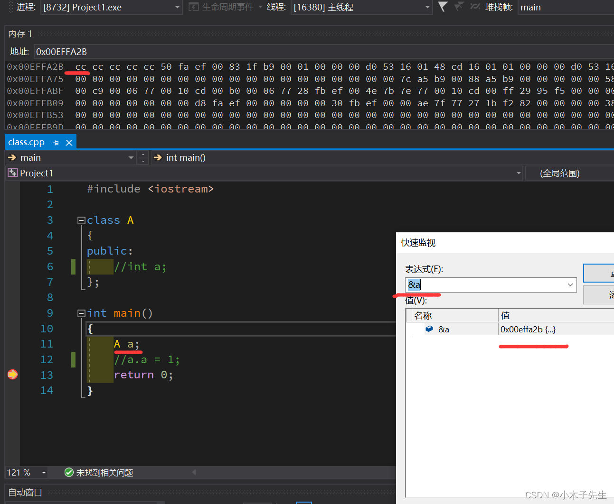
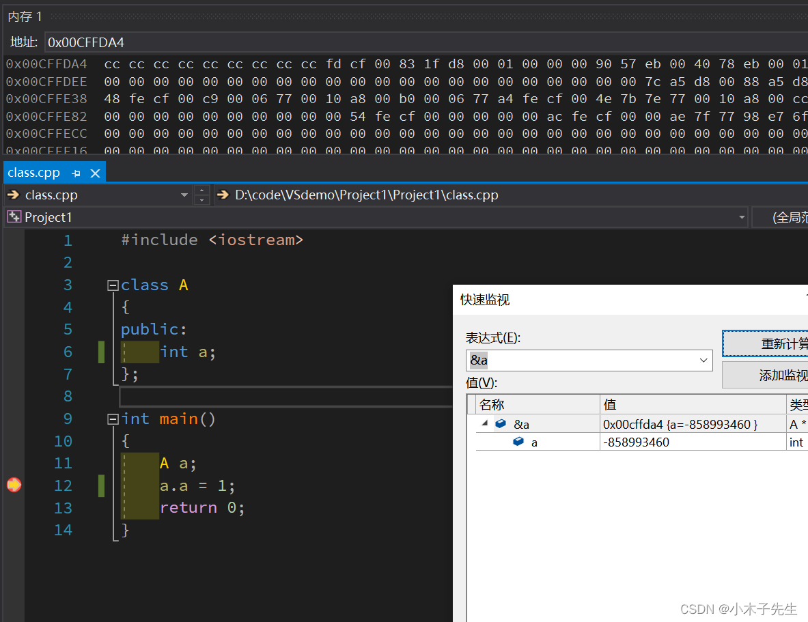
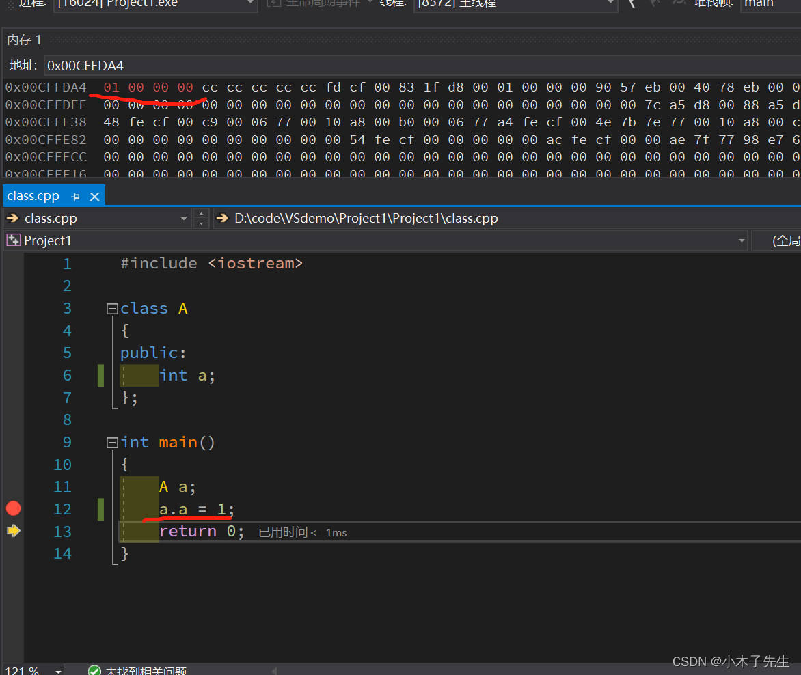

> 搬运来源：CSDN · 小木子先生（HELLO_LW）
> 原文地址：https://blog.csdn.net/HELLO_LW/article/details/131065559

# 一个空对象为什么占1个字节

在八股文中，经常有写道，要给空对象占用1个字节，那么明明是空的，为什么还会占用一个字节？

通过调试可以发现，对象a是有地址的，这个地址刚好占用了1个字节，只要有对象创建就一定会有地址，所以一定会有字节

 现在给对象一个int类型，看一下赋值对内存的改变，现在应该是占用4个字节

辅助操作完成后第一个字节变成了1，后面3个字节都变成了0，对象地址跟第一个遍历应该是用的同一个地址，类似数组和数组地址一样，第0个元素跟数组用的同一个地址

