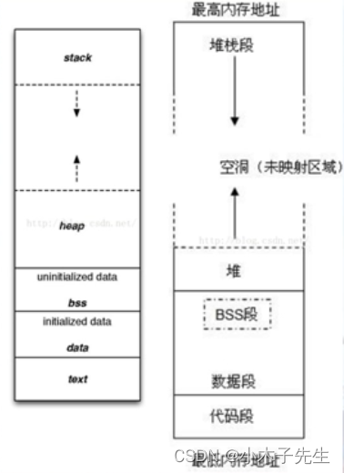

> 搬运来源：CSDN · 小木子先生（HELLO_LW）
> 原文地址：https://blog.csdn.net/HELLO_LW/article/details/131217441

# 内存空间布局

## C++内存空间布局

## 内存分布图



## 代码演示

```cpp
#include <iostream>
#include <cstdio>

int *ptest = new int(120);
int g1;
int g2;
int g3 = 12;
int g4 = 32;
int g5;
int g6 = 0;

static int g7;
static int g8 = 0;
static int g9 = 10;

void mygfunc()
{
	return;
}

class MYACLS
{
public:
	int m_i;
	static int m_si;
	int m_j;
	static int m_sj;
	int m_k;
	static int m_sk;
};
int MYACLS::m_sj = 0;

int main()
{
	printf("ptest地址=%p\n", &ptest);
	printf("g1地址=%p\n", &g1);
	printf("g2地址=%p\n", &g2);
	printf("g3地址=%p\n", &g3);
	printf("g4地址=%p\n", &g4);
	printf("g5地址=%p\n", &g5);
	printf("g6地址=%p\n", &g6);
	printf("g7地址=%p\n", &g7);
	printf("g8地址=%p\n", &g8);
	printf("g9地址=%p\n", &g9);
	printf("MYACLS::m_sj地址=%p\n", &(MYACLS::m_sj));
	printf("mygfunc()地址=%p\n", mygfunc);
	printf("main()地址=%p\n", main);

	std::cout << (void*)mygfunc << std::endl;
}
```

在Linux下使用nm命令查看内存结构

```cpp
000000000000401c B __bss_start
0000000000004150 b completed.8061
                 U __cxa_atexit@@GLIBC_2.2.5
                 w __cxa_finalize@@GLIBC_2.2.5
0000000000004000 D __data_start
0000000000004000 W data_start
0000000000001130 t deregister_tm_clones
00000000000011a0 t __do_global_dtors_aux
0000000000003d78 d __do_global_dtors_aux_fini_array_entry
0000000000004008 D __dso_handle
0000000000003d80 d _DYNAMIC
000000000000401c D _edata
0000000000004180 B _end
0000000000001448 T _fini
00000000000011e0 t frame_dummy
0000000000003d68 d __frame_dummy_init_array_entry
000000000000227c r __FRAME_END__
0000000000004160 B g1
0000000000004164 B g2
0000000000004010 D g3
0000000000004014 D g4
0000000000004168 B g5
000000000000416c B g6
0000000000003f80 d _GLOBAL_OFFSET_TABLE_
00000000000013af t _GLOBAL__sub_I_ptest
                 w __gmon_start__
00000000000020b8 r __GNU_EH_FRAME_HDR
0000000000001000 t _init
0000000000003d78 d __init_array_end
0000000000003d68 d __init_array_start
0000000000002000 R _IO_stdin_used
                 w _ITM_deregisterTMCloneTable
                 w _ITM_registerTMCloneTable
0000000000001440 T __libc_csu_fini
00000000000013d0 T __libc_csu_init
                 U __libc_start_main@@GLIBC_2.2.5
00000000000011f4 T main
                 U printf@@GLIBC_2.2.5
0000000000004158 B ptest
0000000000001160 t register_tm_clones
0000000000001100 T _start
0000000000004020 D __TMC_END__
000000000000134b t _Z41__static_initialization_and_destruction_0ii
00000000000011e9 T _Z7mygfuncv
0000000000004178 b _ZL2g7
000000000000417c b _ZL2g8
0000000000004018 d _ZL2g9
0000000000004170 B _ZN6MYACLS4m_sjE
                 U _ZNSolsEPFRSoS_E@@GLIBCXX_3.4
                 U _ZNSolsEPKv@@GLIBCXX_3.4
                 U _ZNSt8ios_base4InitC1Ev@@GLIBCXX_3.4
                 U _ZNSt8ios_base4InitD1Ev@@GLIBCXX_3.4
                 U _Znwm@@GLIBCXX_3.4
0000000000004040 B _ZSt4cout@@GLIBCXX_3.4
                 U _ZSt4endlIcSt11char_traitsIcEERSt13basic_ostreamIT_T0_ES6_@@GLIBCXX_3.4
0000000000002004 r _ZStL19piecewise_construct
0000000000004174 b _ZStL8__ioinit
```

工具很专业，但是内容太多，不便分析  
还是使用vs输出进行分析

```cpp
ptest地址=0085B2FC
g1地址=0085B2E8
g2地址=0085B2EC
g3地址=0085B000
g4地址=0085B004
g5地址=0085B2F0
g6地址=0085B2F4
g7地址=0085B300
g8地址=0085B304
g9地址=0085B008
MYACLS::m_sj地址=0085B2F8
mygfunc()地址=00851433
main()地址=0085132A
```

## 分析

将地址排个序，从高到第

```cpp
g8地址=0085B304
g7地址=0085B300
ptest地址=0085B2FC
MYACLS::m_sj地址=0085B2F8
g6地址=0085B2F4
g5地址=0085B2F0
g2地址=0085B2EC
g1地址=0085B2E8
g9地址=0085B008
g4地址=0085B004
g3地址=0085B000
mygfunc()地址=00851433
main()地址=0085132A
```

mygfunc()地址=00851433  
main()地址=0085132A  
这俩处于代码段

g9地址=0085B008 全局静态赋值10  
g4地址=0085B004 全局赋值32  
g3地址=0085B000 全局赋值12  
这三个初始化参数了 处于数据段

g8地址=0085B304 静态全局赋值0  
g7地址=0085B300 静态全局未赋值  
ptest地址=0085B2FC 全局指针地址  
MYACLS::m_sj地址=0085B2F8 类静态变量赋值0  
g6地址=0085B2F4 全局未赋值  
g5地址=0085B2F0 全局未赋值  
g2地址=0085B2EC 全局未赋值  
g1地址=0085B2E8 全局未赋值  
这些是初始化参数的，存放在BBS段

而且可以发现，你无论运行几次，这些地址都是不变的

## 总结

全局（静态）存储区分为三段： data 、bss、rodata 段。存储在静态数据区的变量会在程序刚开始运行时就完成初始化，也是唯一的一次初始化。

data 段（全局初始化区）存放初始化的全局变量和静态变量

bss 段（全局未初始化区）存放未初始化的全局变量和静态变量，区别初始化和非初始化是为了空间效率。未初始化变量不占据实际内存空间（bss变量只在段表中记录大小，在符号表中记录符号。当文件加载运行时，才分配空间以及初始化），BBS段在程序执行之前会被系统自动清0，所以未初始化的全局变量和静态变量在程序执行之前已经为0。（也正是因为反正在bss上的变量肯定都是0，所以不需要为他们分配空间）

rodata 段，常量区，用于存放各类常量，如：const、字面量、#define
