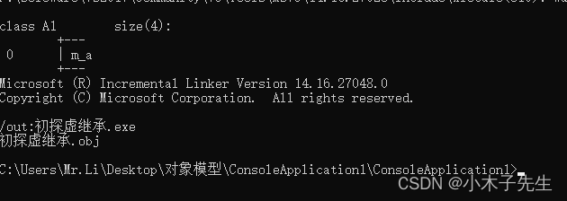
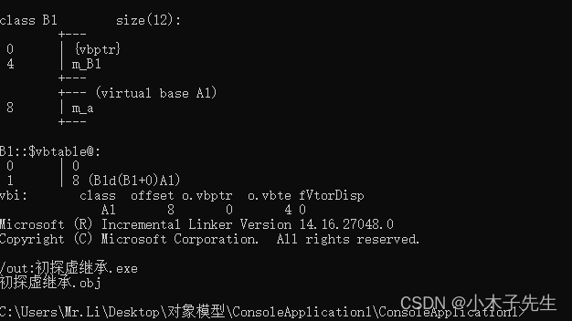
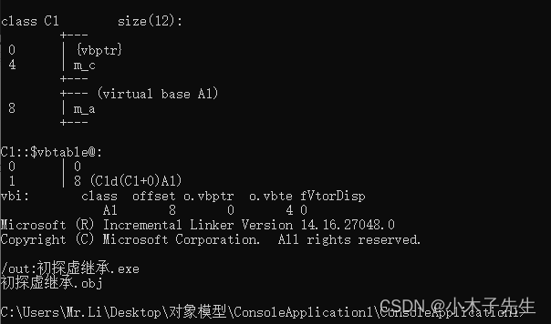
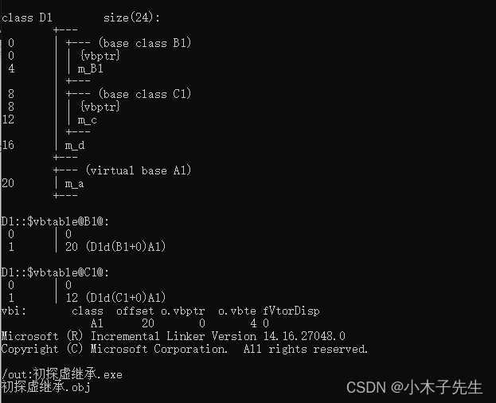

> 搬运来源：CSDN · 小木子先生（HELLO_LW）
> 原文地址：https://blog.csdn.net/HELLO_LW/article/details/131266695

# 初探虚继承

## 为什么会有虚继承

虚继承通常是用来解决菱形继承的，菱形继承会出现二义性。下面举一个简单的例子：

```cpp
#include <iostream>
#include <cstdio>

class A
{
public:
	A(){}
public:
	int m_a;
};

class B : public A
{
public:
	B(){}
};

class C : public A
{
public:
	C(){}
};

class D : public B, public C
{
public:
	D(){}
};

int main()
{
	D d;
	//d.m_a = 1;  报错，二义性
	d.C::m_a = 1;
	d.B::m_a = 2;
	std::cout << sizeof(A) << std::endl;
	std::cout << sizeof(B) << std::endl;
	std::cout << sizeof(C) << std::endl;
	std::cout << sizeof(D) << std::endl;
	return 0;
}
输出：
4
4
4
8
```

看注释的那句话，存在二义性，编译器不知道调用哪一个m_a;  
D占用8个字节，所以里面存在两个m_a  
解决方法就是虚继承，将代码简单修改

```cpp
#include <iostream>
#include <cstdio>

class A
{
public:
	A(){}
public:
	int m_a;
};

class B : virtual public A
{
public:
	B(){}
};

class C : virtual public A
{
public:
	C(){}
};

class D : public B, public C
{
public:
	D(){}
};

int main()
{
	D d;
	d.m_a = 1; 
	std::cout << sizeof(A) << std::endl;
	std::cout << sizeof(B) << std::endl;
	std::cout << sizeof(C) << std::endl;
	std::cout << sizeof(D) << std::endl;
	return 0;
}
输出：
4
8
8
12
```

可以看见，菱形继承解决了二义性，但是sizeof的空间增大了，这时因为多了vbptr

## 虚继承vbptr

跟虚函数一样，只有虚函数就一定会用vptr，占用四个字节，那么虚继承也一样，只要有虚继承就一定会有vbptr也是占用4个字节，上面的代码b和c各自都有一个vbptr所以会多4个字节，d因为继承了b和c所以多了两个vbptr

## 虚继承的内存布局

将代码简单改造

```cpp
#include <iostream>
#include <cstdio>

class A1
{
public:
	A1()
	{
		printf("A的this=%p\n", this);
	}
public:
	int m_a;
};

class B1 : virtual public A1
{
public:
	B1()
	{
		printf("B1的this=%p\n", this);
	}
public:
	int m_B1;
};

class C1 : virtual public A1
{
public:
	C1()
	{
		printf("C的this=%p\n", this);
	}
public:
	int m_c;
};

class D1 : public B1, public C1
{
public:
	D1()
	{
		printf("D的this=%p\n", this);
	}
public:
	int m_d;
};

int main()
{
	D1 d;
	d.m_a = 1; 
	return 0;
}
输出：
A的this=001CFDE0
B的this=001CFDCC
C的this=001CFDD4
D的this=001CFDCC
```

看到B和C占用一个this，A和B都是单独的，根据顺序B->C->A

## 借助VS工具看一下vbtable

### A类

cl /d1 reportSingleClassLayoutA1 初探虚继承.cpp  
  
A类就一个m_a变量

### B类

cl /d1 reportSingleClassLayoutB1 初探虚继承.cpp  
  
B类有一个vbptr和m_b1变量和父类m_a的变量

### C类

cl /d1 reportSingleClassLayoutC1 初探虚继承.cpp  
  
C类有一个vbptr和m_c变量和父类的m_a变量

### D类

cl /d1 reportSingleClassLayoutD1 初探虚继承.cpp  
  
B类有B1和C1的vbptr和变量，还有自己的m_a变量，和爷爷类A1的变量m_a，可以发现一个细节，在虚继承中虚继承的类永远都是放在最后的！！！
