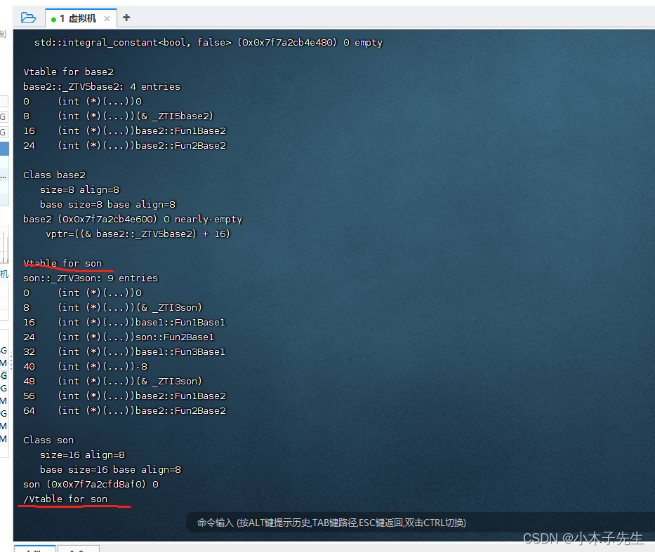

> 搬运来源：CSDN · 小木子先生（HELLO_LW）
> 原文地址：https://blog.csdn.net/HELLO_LW/article/details/131178959

# 利用工具查看vftable

## 利用工具查看vftable

## window

下载了vs会自带一个VS 2017的开发人员命令提示符，我们借助它来查看vftable  
首先准备一段代码

```cpp
#include <iostream>

class base1
{
public:
	base1(){}
	virtual void Fun1Base1() { std::cout << "base1::Fun1Base1" << std::endl; }
	virtual void Fun2Base1() { std::cout << "base1::Fun2Base1" << std::endl; }
	virtual void Fun3Base1() { std::cout << "base1::Fun3Base1" << std::endl; }
};

class base2
{
public:
	base2(){}
	virtual void Fun1Base2() { std::cout << "base2::Fun1Base2" << std::endl; }
	virtual void Fun2Base2() { std::cout << "base2::Fun2Base2" << std::endl; }
};

class son: public base1 , public base2
{
public:
	son(){}
	virtual void Fun2Base1() { std::cout << "son::Fun2Base1" << std::endl; }
};

int main()
{
	son s;
	typedef void(*Fun)(void);
	// vptr1
	long* vptrs1 = (long*)&s;
	long* vptr1 = (long*)*vptrs1;
	Fun v1f1 = (Fun)vptr1[0];
	Fun v1f2 = (Fun)vptr1[1];
	Fun v1f3 = (Fun)vptr1[2];
	v1f1();
	v1f2();
	v1f3();
	//vptr2
	long* vptrs2 = (long*)(vptrs1 + 1);
	long* vptr2 = (long*)*vptrs2;
	Fun v2f1 = (Fun)vptr2[0];
	Fun v2f2 = (Fun)vptr2[1];
	v2f1();
	v2f2();
	return 0;
}
```

打开辅助工具，进入到项目目录，输入指令  
cl /d1 reportSingleClassLayout类名 文件名.cpp  
接下来就会出现结构了

```cpp
class son       size(8):
        +---
 0      | +--- (base class base1)
 0      | | {vfptr}
        | +---
 4      | +--- (base class base2)
 4      | | {vfptr}
        | +---
        +---

son::$vftable@base1@:
        | &son_meta
        |  0
 0      | &base1::Fun1Base1
 1      | &son::Fun2Base1
 2      | &base1::Fun3Base1

son::$vftable@base2@:
        | -4
 0      | &base2::Fun1Base2
 1      | &base2::Fun2Base2

son::Fun2Base1 this adjustor: 0
```

以我的为例，可以看到有2个vptr，每个vptr的指向都写的清清楚楚

## Linux

Linux也有相同的好用的东西，跟上面的代码相同  
先通过命令生成class文件  
g++ -fdump-lang-class first.cpp  
在打开.class文件  
vim first.cpp.001l.class  
由于文件太多，使用搜索功能去查找，可以看见son的vftable，写的非常的详细  

