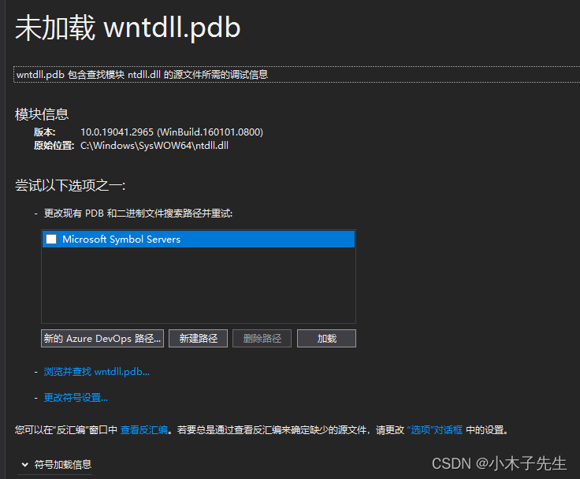

> 搬运来源：CSDN · 小木子先生（HELLO_LW）
> 原文地址：https://blog.csdn.net/HELLO_LW/article/details/131261586

# 多继承下数据成员布局

## 继承下数据成员布局

将分类讨论类中的成员布局

## 无继承子类有虚函数

```cpp
#include <iostream>
#include <cstdio>
class Son
{
public:
	Son(){}
	~Son(){}
	virtual void MYCALSFun1()
	{
		printf("Son::this=%p\n", this);
		printf("MYCALS::a=%p\n", &Son::a);
		printf("MYCALS::b=%p\n", &Son::b);
	}
public:
	int a;
	int b;
};
int main()
{
	Son s;
	s.MYCALSFun1();
	return 0;
}
输出：
Son::this=00BAFADC
MYCALS::a=00000004
MYCALS::b=00000008
内存布局：
0x00BAFADC  34 9c a9 00 cc cc cc cc cc cc cc cc
```

### 分析

该类占12个字节，分别为两个int类型和1个虚函数指针，this与vptr公用地址，a偏移4个地址，b便宜8个地址，内存布局为vptr->a->b

## 单继承子有虚函数父无虚函数

```cpp
#include <iostream>
#include <cstdio>

class Base
{
public:
	Base()
	{
		printf("Base::this=%p\n", this);
	}
	~Base(){}
public:
	int c;
};

class Son : public Base
{
public:
	Son()
	{
		printf("Son::this=%p\n", this);
	}
	~Son(){}
	virtual void MYCALSFun1(){}
public:
	int a;
	int b;
};

int main()
{
	Son s;
	s.a = 1, s.b = 2, s.c = 3;
	printf("MYCALS::c=%p\n", &Son::c);
	printf("MYCALS::a=%p\n", &Son::a);
	printf("MYCALS::b=%p\n", &Son::b);

	return 0;
}
输出：
Base::this=012FF6F4
Son::this=012FF6F0
MYCALS::c=00000000
MYCALS::a=00000008
MYCALS::b=0000000C
内存：
0x012FF6F0  40 9c 17 00 03 00 00 00 01 00 00 00 02 00 00 00
```

### 分析

son的this指针与对象的地址相同，Base的this指针与变量c的地址相同，所以c偏移值为0，c的参照是Base。布局顺序是vptr->c->a->b

## 单继承父子都有虚函数

```cpp
#include <iostream>
#include <cstdio>

class Base
{
public:
	Base()
	{
		printf("Base::this=%p\n", this);
	}
	~Base(){}
	virtual void BaseFun1(){}
public:
	int c;
};

class Son : public Base
{
public:
	Son()
	{
		printf("Son::this=%p\n", this);
	}
	~Son(){}
	virtual void MYCALSFun1(){}
public:
	int a;
	int b;
};

int main()
{
	Son s;
	s.a = 1, s.b = 2, s.c = 3;
	printf("MYCALS::c=%p\n", &Son::c);
	printf("MYCALS::a=%p\n", &Son::a);
	printf("MYCALS::b=%p\n", &Son::b);
	return 0;
}
输出：
Base::this=010FFEB8
Son::this=010FFEB8
MYCALS::c=00000004
MYCALS::a=00000008
MYCALS::b=0000000C
内存：
0x0133F76C  50 9c e1 00 03 00 00 00 01 00 00 00 02 00 00 00
```

### 分析

子父类公用一个this指针，要么都有虚函数，要么都没有虚函数，此时父子类才会共用一个this，c的偏移改变，从刚刚的0变成了4，原因就是this指针相同了，布局顺序是vptr->c->a->b

## 多继承都有虚函数

```cpp
#include <iostream>
#include <cstdio>

class Base
{
public:
	Base()
	{
		printf("Base::this=%p\n", this);
	}
	~Base(){}
	virtual void BaseFun1(){}
public:
	int c;
};

class Base2
{
public:
	Base2()
	{
		printf("Base2::this=%p\n", this);
	}
	virtual void Base2Fun1(){}
public:
	int d;
};

class Son : public Base, public Base2
{
public:
	Son()
	{
		printf("Son::this=%p\n", this);
	}
	~Son(){}
	virtual void MYCALSFun1(){}
public:
	int a;
	int b;
};

int main()
{
	Son s;
	s.a = 1, s.b = 2, s.c = 3, s.d = 4;
	printf("MYCALS::c=%p\n", &Son::c);
	printf("MYCALS::a=%p\n", &Son::a);
	printf("MYCALS::b=%p\n", &Son::b);
	printf("MYCALS::d=%p\n", &Son::d);
	return 0;
}
输出：
Base::this=00D0FAC0
Base2::this=00D0FAC8
Son::this=00D0FAC0
MYCALS::c=00000004
MYCALS::a=00000010
MYCALS::b=00000014
MYCALS::d=00000004
内存：
0x00D0FAC0  0c 9e bf 00 03 00 00 00 1c 9e bf 00 04 00 00 00 01 00  .??......??.......
0x00D0FAD2  00 00 02 00 00 00
```

### 分析

Base和Son共用一个this指针，Base2单独一个Base指针，c相对于Base的this偏移了4，d相对于Base2的this偏移了4，a是偏移了10（H）也就是16，是Base的偏移+Base2的偏移，b偏移了14（H），在a的基础上多了4，布局顺序：Basevptr->c->Base2vptr->d->a->b

## 多态直接的相互转换

使用上面的代码进行改进

```cpp
#include <iostream>
#include <cstdio>

class Base
{
public:
	Base()
	{
		c = 3;
		printf("Base::this=%p\n", this);
	}
	~Base(){}
	virtual void BaseFun1(){}
public:
	int c;
};

class Base2
{
public:
	Base2()
	{
		d = 4;
		printf("Base2::this=%p\n", this);
	}
	virtual void Base2Fun1(){}
public:
	int d;
};

class Son : public Base, public Base2
{
public:
	Son()
	{
		a = 1, b = 2;
		printf("Son::this=%p\n", this);
	}
	~Son(){}
	virtual void MYCALSFun1(){}
public:
	int a;
	int b;
};

int main()
{
	Base *b1 = new Son();
	Son *s = (Son*)b1;
	Base2 *b2 = s;
	return 0;
}
地址：
b1=014E9DE8
s=014E9DF0
b2=014E9DE8
内存：
0x014E9DE8  0c 9e 58 00 03 00 00 00 1c 9e 58 00 04 00 00 00 01 00  .?X......?X.......
0x014E9DFA  00 00 02 00 00 00
```

### 分析

在指针进行强制类型转换的时候其实只是做了指针的偏移来完成的

## 多继承释放的不是第一个this指针造成的后果

在多继承中，指针是可以来回转换的，上串代码中base、base1、son的指针都是可以互相转换的，但是释放并不是都可以释放的，b1和s的this是指向头节点的，是可以释放没有问题的，但是b2的指针并不是头节点，他是在中间的，释放的时候就会异常，如下：  

