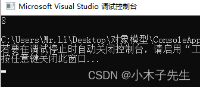
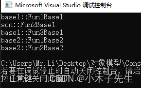
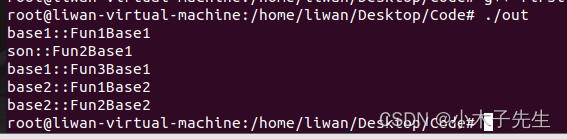

> 搬运来源：CSDN · 小木子先生（HELLO_LW）
> 原文地址：https://blog.csdn.net/HELLO_LW/article/details/131160520

# 多继承下的vftable调用

## 多继承下的vftable调用

之前写了单继承的vftable怎么调用，这一篇是关于多继承的

## 多继承有几个vptr

代码验证

```cpp
#include <iostream>

class base1
{
public:
	base1(){}
	virtual void Fun1Base1() { std::cout << "base1::FunBase1" << std::endl; }
};

class base2
{
public:
	base2(){}
	virtual void Fun1Base2() { std::cout << "base2::FunBase2" << std::endl; }
};

class son: public base1 , public base2
{
public:
	son(){}

};

int main()
{
	std::cout << sizeof(son) << std::endl;
	return 0;
}
```

  
输出是8，所以推断有两个vptr，之前也说过this只想问题，son对象base1公用的一个vptr

## 手动调用vftable

因为之前验证过vptr是在对象内存的最开头的，刚刚也验证过是有两个vptr的，那么只需要拿到第一个vptr地址+1就可以得到第二个vptr了，代码如下

```cpp
#include <iostream>

class base1
{
public:
	base1(){}
	virtual void Fun1Base1() { std::cout << "base1::Fun1Base1" << std::endl; }
	virtual void Fun2Base1() { std::cout << "base1::Fun2Base1" << std::endl; }
	virtual void Fun3Base1() { std::cout << "base1::Fun3Base1" << std::endl; }
};

class base2
{
public:
	base2(){}
	virtual void Fun1Base2() { std::cout << "base2::Fun1Base2" << std::endl; }
	virtual void Fun2Base2() { std::cout << "base2::Fun2Base2" << std::endl; }
};

class son: public base1 , public base2
{
public:
	son(){}
	virtual void Fun2Base1() { std::cout << "son::Fun2Base1" << std::endl; }
};

int main()
{
	son s;
	typedef void(*Fun)(void);
	// vptr1
	long* vptrs1 = (long*)&s;
	long* vptr1 = (long*)*vptrs1;
	Fun v1f1 = (Fun)vptr1[0];
	Fun v1f2 = (Fun)vptr1[1];
	Fun v1f3 = (Fun)vptr1[2];
	v1f1();
	v1f2();
	v1f3();
	//vptr2
	long* vptrs2 = (long*)(vptrs1 + 1);
	long* vptr2 = (long*)*vptrs2;
	Fun v2f1 = (Fun)vptr2[0];
	Fun v2f2 = (Fun)vptr2[1];
	v2f1();
	v2f2();
	return 0;
}
```

  
跟我们的预想一模一样！  
下面在Linux下跑一遍看看效果是否一样在这里插入图片描述  
  
在linux下也是一模一样
