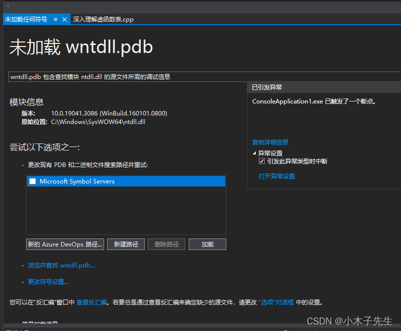
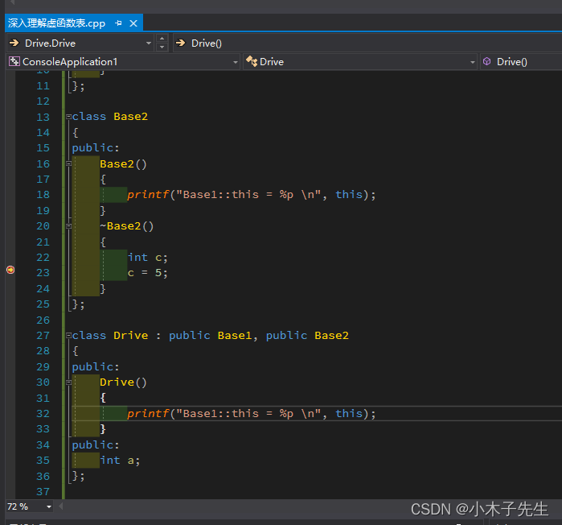
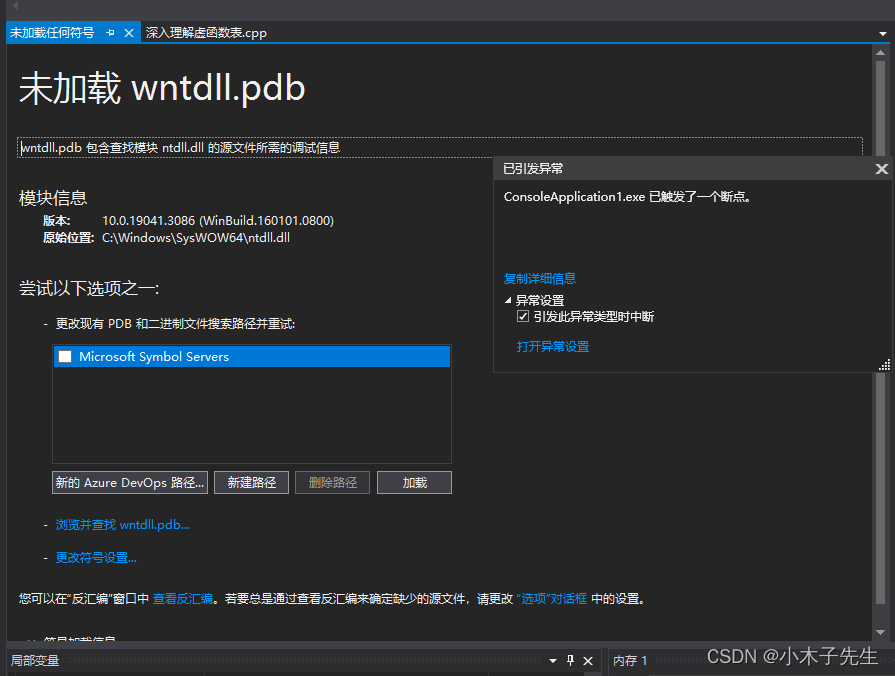
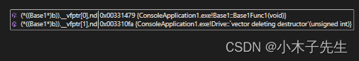
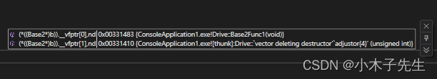

> 搬运来源：CSDN · 小木子先生（HELLO_LW）
> 原文地址：https://blog.csdn.net/HELLO_LW/article/details/131355463

# 深入理解虚函数表

## 深入理解虚函数表

以代码论证的方式来深入理解虚函数表并阐述虚析构函数的重要性

## 代码1

```cpp
#include <iostream>

class Base1
{
public:
	Base1(){}
};

class Base2
{
public:
	Base2(){}
};

class Drive : public Base1, public Base2
{
public:
	Drive(){}
public:
	int a;
};
int main()
{
	Base2 *b = new Drive();
	delete b;
	return 0;
}
```

### 存在问题

运行这段代码，程序是会崩溃的，会弹出以下内容并崩掉程序  


### 分析代码的问题

我们new的是一个Drive，但是接的是一个Base2类型，也就是说在赋值的时候指针偏移了，并不是指向Drive的头节点，所以他不知道要释放什么，就导致了程序崩溃

### 尝试修改代码1

我们将代码简单的修改看一下问题，添加一个虚函数

```cpp
#include <iostream>
#include <cstdio>

class Base1
{
public:
	Base1()
	{
		printf("Base1::this = %p \n", this);
	}
};

class Base2
{
public:
	Base2()
	{
		printf("Base1::this = %p \n", this);
	}
	~Base2()
	{
		int c;
		c = 5;
	}
};

class Drive : public Base1, public Base2
{
public:
	Drive()
	{
		printf("Base1::this = %p \n", this);
	}
public:
	int a;
};

int main()
{
	Base2 *b = new Drive();
	delete b;
	return 0;
}
```

运行这串代码的时候是可以进入的析构函数中去的，看下面的debug的图，可以看到是进去了的  
  
但是当虚函数的结束的时候还是崩溃了，错误跟之前是一样的  


### 尝试修改代码1

把之前的析构函数编程虚析构函数

```cpp
#include <iostream>
#include <cstdio>

class Base1
{
public:
	Base1()
	{
		printf("Base1::this = %p \n", this);
	}
};

class Base2
{
public:
	Base2()
	{
		printf("Base1::this = %p \n", this);
	}
	virtual ~Base2()
	{
		int c;
		c = 5;
	}
};

class Drive : public Base1, public Base2
{
public:
	Drive()
	{
		printf("Base1::this = %p \n", this);
	}
public:
	int a;
};

int main()
{
	Base2 *b = new Drive();
	delete b;
	return 0;
}
```

运气很好，这次程序没有崩溃，是虚析构函数起了作用，可见虚析构函数的重要性

### 为什么加了虚析构程序就不崩溃了？

将代码进行简单的改造

```cpp
#include <iostream>
#include <cstdio>

class Base1
{
public:
	Base1()
	{
		printf("Base1::this = %p \n", this);
	}
	virtual void Base1Func1(){}
	virtual ~Base1() {	}
};

class Base2
{
public:
	Base2()
	{
		printf("Base1::this = %p \n", this);
	}
	virtual void Base2Func1() {}
	virtual ~Base2(){	}
};

class Drive : public Base1, public Base2
{
public:
	Drive()
	{
		printf("Base1::this = %p \n", this);
	}
	virtual void Base2Func1() {}
	virtual ~Drive() {	}
public:
	int a;
};

int main()
{
	Drive *b = new Drive();
	return 0;
}
```

### 观察vftable

第一个vftable的内容  
  
第二个vftable的内容  
  
可以看见这两个虚函数都是偏移值，用的是一个thunk来操作的

## thunk是什么

在 C++ 中，Thunk（中间曾，也称为跳转代码）是一种用于实现函数指针调用的机制。Thunk 主要用于解决函数调用时的调用约定（calling convention）不匹配的问题。  
函数调用约定定义了函数如何传递参数、返回值的方式以及栈的使用方式等规则。不同的编译器和平台可能采用不同的调用约定，例如 cdecl、stdcall、fastcall 等。当使用函数指针调用不符合调用约定的函数时，Thunk 被用来提供一个中间层，将函数指针调用和实际函数调用之间进行转换。  
Thunk 的作用包括以下几个方面：

1. 调整调用约定：当函数指针的调用约定与实际函数的调用约定不匹配时，Thunk可以帮助进行调整。它可以处理参数的传递方式、返回值的处理和栈的调整等，确保符合目标函数的调用约定。
2. 处理成员函数指针：对于成员函数指针，由于需要额外的对象指针来进行调用，Thunk可以帮助将成员函数指针与对象的地址结合，并正确调用成员函数。
3. 跳转到正确的函数地址：有时在函数指针调用中，可能需要进行跳转到不同的函数地址。Thunk可以根据需要进行动态的跳转，确保执行正确的函数代码。

Thunk 的具体实现可能因编译器和平台而异。通常，Thunk 是由编译器生成的一段代码，它位于函数指针调用的路径上，并负责处理调用约定的适配和跳转到正确的函数地址。  
需要注意的是，Thunk 的引入可能会产生一些额外的性能开销和代码冗余，因为需要引入额外的中间层。在某些情况下，使用 Thunk 可能会拖慢函数指针的调用速度。因此，在编写高性能代码时，需要进行适当的权衡和优化。

## 观察汇编，分析thunk干了什么

废话不多说，直接跟代码

```cpp
Base2的虚析构函数地址 00DB1488
----------------------------------------------------------------------
Drive::`vector deleting destructor':
00DB1488  jmp         Drive::`vector deleting destructor' (0DB30C5h) 	// 跳转
----------------------------------------------------------------------
Drive::`vector deleting destructor':
00DB30C5  sub         ecx,8  
00DB30C8  jmp         Drive::`vector deleting destructor' (0DB10FAh)   // 跳转
----------------------------------------------------------------------
Drive::`vector deleting destructor':
00DB10FA  jmp         Drive::`scalar deleting destructor' (0DB31B0h)
----------------------------------------------------------------------
Drive::`vector deleting destructor':
00DB31B0  push        ebp  
00DB31B1  mov         ebp,esp  
00DB31B3  sub         esp,0CCh  
00DB31B9  push        ebx  
00DB31BA  push        esi  
00DB31BB  push        edi  
00DB31BC  push        ecx  
00DB31BD  lea         edi,[ebp-0CCh]  
00DB31C3  mov         ecx,33h  
00DB31C8  mov         eax,0CCCCCCCCh  
00DB31CD  rep stos    dword ptr es:[edi]  
00DB31CF  pop         ecx  
00DB31D0  mov         dword ptr [this],ecx  
00DB31D3  mov         ecx,dword ptr [this]  
00DB31D6  call        Drive::~Drive (0DB1190h)  	//调用了子类的析构函数
00DB31DB  mov         eax,dword ptr [ebp+8]  
00DB31DE  and         eax,1  
00DB31E1  je          Drive::`scalar deleting destructor'+41h (0DB31F1h)  
00DB31E3  push        14h  
00DB31E5  mov         eax,dword ptr [this]  
00DB31E8  push        eax  
00DB31E9  call        operator delete (0DB1294h)  
00DB31EE  add         esp,8  
00DB31F1  mov         eax,dword ptr [this]  
00DB31F4  pop         edi  
00DB31F5  pop         esi  
00DB31F6  pop         ebx  
00DB31F7  add         esp,0CCh  
00DB31FD  cmp         ebp,esp  
00DB31FF  call        __RTC_CheckEsp (0DB12B2h)  
00DB3204  mov         esp,ebp  
00DB3206  pop         ebp 
----------------------------------------------------------------------
Drive::~Drive:
00DB1190  jmp         Drive::~Drive (0DB3010h) 
----------------------------------------------------------------------
    36: 	virtual ~Drive() {	}
00DB3010  push        ebp  
00DB3011  mov         ebp,esp  
00DB3013  push        0FFFFFFFFh  
00DB3015  push        0DB8170h  
00DB301A  mov         eax,dword ptr fs:[00000000h]  
00DB3020  push        eax  
00DB3021  sub         esp,0CCh  
00DB3027  push        ebx  
00DB3028  push        esi  
00DB3029  push        edi  
00DB302A  push        ecx  
00DB302B  lea         edi,[ebp-0D8h]  
00DB3031  mov         ecx,33h  
00DB3036  mov         eax,0CCCCCCCCh  
00DB303B  rep stos    dword ptr es:[edi]  
00DB303D  pop         ecx  
00DB303E  mov         eax,dword ptr [__security_cookie (0DBD010h)]  
00DB3043  xor         eax,ebp  
00DB3045  push        eax  
00DB3046  lea         eax,[ebp-0Ch]  
00DB3049  mov         dword ptr fs:[00000000h],eax  
00DB304F  mov         dword ptr [this],ecx  
00DB3052  mov         ecx,offset _901F90A7_深入理解虚函数表@cpp (0DBF216h)  
00DB3057  call        @__CheckForDebuggerJustMyCode@4 (0DB12A3h)  
00DB305C  mov         eax,dword ptr [this]  
00DB305F  mov         dword ptr [eax],offset Drive::`vftable' (0DBAC64h)  
00DB3065  mov         eax,dword ptr [this]  
00DB3068  mov         dword ptr [eax+8],offset Drive::`vftable' (0DBAC70h)  
00DB306F  mov         ecx,dword ptr [this]  
00DB3072  add         ecx,8  
00DB3075  call        Base2::~Base2 (0DB128Fh)  	//调用了父类析构
00DB307A  mov         ecx,dword ptr [this]  
00DB307D  call        Base1::~Base1 (0DB1140h)  	//调用了父类析构
00DB3082  mov         ecx,dword ptr [ebp-0Ch]  
00DB3085  mov         dword ptr fs:[0],ecx  
00DB308C  pop         ecx  
00DB308D  pop         edi  
00DB308E  pop         esi  
00DB308F  pop         ebx  
00DB3090  add         esp,0D8h  
00DB3096  cmp         ebp,esp  
00DB3098  call        __RTC_CheckEsp (0DB12B2h)  
00DB309D  mov         esp,ebp  
00DB309F  pop         ebp  
00DB30A0  ret 
```

### 汇编总结

它通过thunk偏移，跳转了很多函数，但是最终还是调用了子类的析构函数，子类的析构函数调用了两个父类的析构函数，完成了内存的释放！  
一定一定一定要写虚析构函数

## 什么时候vftable的值会编程一个thunk？

### 第一种情况

一般来说，只要是有继承关系，析构函数是虚的，那么它虚函数表中的虚析构函数的地址一定是一个thunk

### 第二种情况

在继承中，子类重写了父类的方法，下面用代码演示

```cpp
#include <iostream>
#include <cstdio>

class Base1
{
public:
	Base1()
	{
		printf("Base1::this = %p \n", this);
	}
	virtual void Base2Func1(){}
	virtual ~Base1() {	}
	int c;
};

class Base2
{
public:
	Base2()
	{
		printf("Base1::this = %p \n", this);
	}
	virtual void Base2Func1() { int a; }
	virtual ~Base2(){	}
	int b;
};

class Drive : public Base1, public Base2
{
public:
	Drive()
	{
		printf("Base1::this = %p \n", this);
	}
	virtual void Base2Func1() { int b; }
	virtual ~Drive() {	}
public:
	int a;
};

int main()
{
	Drive *d = new Drive();
	return 0;
}
```

在这串代码种，Base1、Base2、Drive 都有一个相同的函数virtual void Base2Func1()，这个时候Base2的虚函数表的Base2Func1的地方就是一个thunk，但是Base1虚函数表种Base2Func1的地方不是thunk，是正常的地址。  
在多继承中子类和父类同时拥有同一个函数，那么后继承的对象中的函数地址就是thunk

```cpp
#include <iostream>
#include <cstdio>

class Base1
{
public:
	Base1()
	{
		printf("Base1::this = %p \n", this);
	}
	virtual void Base2Func1(){}
	virtual ~Base1() {	}
	int c;
};

class Base2
{
public:
	Base2()
	{
		printf("Base1::this = %p \n", this);
	}
	virtual void Base2Func1() { int a; }
	virtual ~Base2(){	}
	int b;
};

class Drive : public Base1, public Base2
{
public:
	Drive()
	{
		printf("Base1::this = %p \n", this);
	}
	//virtual void Base2Func1() { int b; }
	virtual ~Drive() {	}
public:
	int a;
};

int main()
{
	Drive *d = new Drive();
	return 0;
}
```

这一串代码有一点修改，就是把子类的virtual void Base2Func1()给注释掉了，这个时候两个父类的虚函数表的Base2Func1位置都是thunk，这个时候直接通过d去调用Base2Func1会出现不明确的行为

### 总结

在多继承中虚析构函数一定是thunk  
在多继承中普通函数一般出现不明确行为时会编程thunk
