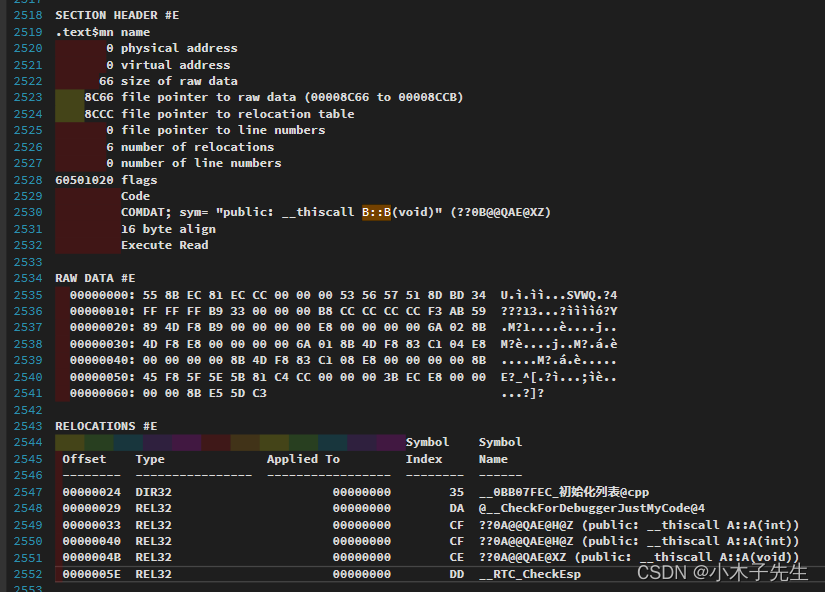

> 搬运来源：CSDN · 小木子先生（HELLO_LW）
> 原文地址：https://blog.csdn.net/HELLO_LW/article/details/131144582

# 简单理解COFF文件

## COFF文件

COFF文件是我在初学对象模型的时候看底层代码用的，是通过obj文件转换的，也就是一种目标文件  
官方描述：  
COFF（Common Object File Format）是一种常见的目标文件格式，用于存储可重定位目标文件、静态库文件和可执行文件。COFF最初由UNIX System Laboratories（USL）定义，现在被广泛地使用在各种操作系统上，包括Windows、Linux和BSD等。  
COFF格式的目标文件由多个段（Section）组成，每个段包含一定范围的数据，例如代码、数据和符号表等。每个段都有一个段头（Section Header），它包含有关该段的信息，例如名称、大小、地址、属性等。段头表（Section Header Table）记录了所有段头的信息。  
COFF格式的可执行文件由多个段、符号表和重定位表等组成。符号表用于记录程序中的符号信息，例如函数名和变量名，重定位表则用于在程序加载时对代码中的符号和地址进行重定位。可执行文件还包含程序入口点和其他可执行代码相关的元数据。  
COFF是一种通用格式，它被多种编译器、链接器和调试器所支持。具体而言，COFF格式在Windows和MS-DOS上得到广泛应用，在Unix/Linux上也有被广泛使用。

## 尝试阅读COFF

为了看懂C++底层是如何运行的，就必须要让自己学会看一些正常人不喜欢的看的文件，比如说COFF文件  
先来一串代码

```cpp
#include <iostream>

class A
{
public:
	A()
	{
		std::cout << "构造函数" << std::endl;
	}
	A(int a)
	{
		std::cout << a << std::endl;
	}
public:
	int a;
};

class B
{
public:
	B():tempa(1), tempb(2) {}
public:
	A tempb;
	A tempa;
	A tempc;
};

int main()
{
	B b;
	return 0;
}
```

先来分析以下这个代码，就是一个比较简单的初始化列表的代码，代码的执行应该是：

1. 执行tempb的有参构造函数
2. 执行tempa的有参构造函数
3. 执行tempc的无参构造函数  
   先在来看一下COFF文件

```cpp
SECTION HEADER #E
.text$mn name
       0 physical address
       0 virtual address
      66 size of raw data
    8C66 file pointer to raw data (00008C66 to 00008CCB)
    8CCC file pointer to relocation table
       0 file pointer to line numbers
       6 number of relocations
       0 number of line numbers
60501020 flags
         Code
         COMDAT; sym= "public: __thiscall B::B(void)" (??0B@@QAE@XZ)
         16 byte align
         Execute Read

RAW DATA #E
  00000000: 55 8B EC 81 EC CC 00 00 00 53 56 57 51 8D BD 34  U.ì.ìì...SVWQ.?4
  00000010: FF FF FF B9 33 00 00 00 B8 CC CC CC CC F3 AB 59  ???13...?ììììó?Y
  00000020: 89 4D F8 B9 00 00 00 00 E8 00 00 00 00 6A 02 8B  .M?1....è....j..
  00000030: 4D F8 E8 00 00 00 00 6A 01 8B 4D F8 83 C1 04 E8  M?è....j..M?.á.è
  00000040: 00 00 00 00 8B 4D F8 83 C1 08 E8 00 00 00 00 8B  .....M?.á.è.....
  00000050: 45 F8 5F 5E 5B 81 C4 CC 00 00 00 3B EC E8 00 00  E?_^[.?ì...;ìè..
  00000060: 00 00 8B E5 5D C3                                ...?]?

RELOCATIONS #E
                                                Symbol    Symbol
 Offset    Type              Applied To         Index     Name
 --------  ----------------  -----------------  --------  ------
 00000024  DIR32                      00000000        35  __0BB07FEC_初始化列表@cpp
 00000029  REL32                      00000000        DA  @__CheckForDebuggerJustMyCode@4
 00000033  REL32                      00000000        CF  ??0A@@QAE@H@Z (public: __thiscall A::A(int))
 00000040  REL32                      00000000        CF  ??0A@@QAE@H@Z (public: __thiscall A::A(int))
 0000004B  REL32                      00000000        CE  ??0A@@QAE@XZ (public: __thiscall A::A(void))
 0000005E  REL32                      00000000        DD  __RTC_CheckEsp
```

  
图片跟上面帖的代码是一样的，这里只取了一部分，因为我也看不懂，只是做一个记录。

### 2518行 SECTION HEADER

是指可执行文件中的一个头部部分，其描述了程序段的一些信息，例如代码段的起始物理和虚拟地址（偏移），以及每个程序段的大小等等。  
#E   
在可执行文件和目标文件中，每个节/段通常都有一个称为节/段头（section header）或段头（segment header）的数据结构，它包含有关该节/段的信息，例如大小，位置和访问权限。这个节头的标识符通常由一个字母或数字来标识。在这里，#E 中的 E 是这个段头标识符的一部分，表示这个段是代表可执行代码的代码段（Code）。节头标识符是使用一定的规则来定义的，可以在文档中找到具体的说明。

### 2530行 COMDAT

是指一种在C++中进行优化的方法，它可以在编译时去重复代码块。在这里的COMDAT表明了编译器可以将B类的构造函数的代码进行去重复。  
对于COMDAT中的符号，编译器在处理不同的模块（.obj文件或库）时，通常会为处于相同COMDAT组的相同符号创建一个单一的副本。这种机制可以有效减小可执行文件和动态链接库的大小。这里的“去重”意思是指编译器将 B 类的构造函数的代码从其他处引用的代码独立出来，只在需要调用构造函数的地方生成一遍该代码。这样可以减少可执行文件中的冗余代码，减小程序体积，并加快程序的启动和运行速度。

### 2531行 16 byte align

指示了这个程序段的起始位置需要按照16字节的对齐方式进行排列。

### 2532行 Execute Read

表明了这个程序段被加载到内存中后，可以被执行，也可以被读取。

### 2534行 RAW DATA

是指在可执行文件中以原始二进制形式存储的程序代码，这里的每一条机器码表示CPU指令。

### 2543行 RELOCATIONS

是指可执行文件中的一个信息表，其中包含了需要在程序运行时进行重新定位的数据和代码的位置。在这里，出现了6个RELOCATIONS，指示了6个位置需要进行重新定位操作。其中每个RELOCATION包含了：  
a. 在程序中的偏移量（Offset）  
b. 重新定位类型（Type）  
c. 需要进行重定位的程序数据/指令（Applied To）  
d. 符号表（Symbol Table）中的某个符号（Symbol Name）对应的索引（Symbol Index）

可以看到根据它的执行顺序先执行了A的有参构造，在执行了A的有参构造，在执行了A的无参构造，跟我们的设想是一样的

### 2552 __RTC_CheckEsp

这个符号，它可能是与Microsoft Visual C++ 一起使用的运行时检查器的一部分，这个检查器用于抓住C++编程错误，例如数组越界

目前笔者的能力只能到这里！
