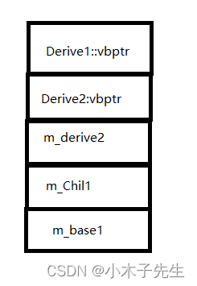
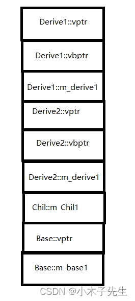

> 搬运来源：CSDN · 小木子先生（HELLO_LW）
> 原文地址：https://blog.csdn.net/HELLO_LW/article/details/131352164

# 菱形继承第三层内存分析

## 菱形继承第三层内存分析

深入探索虚继承中第三层的内存分析，深入了解内存模型

## 菱形继承，无虚函数

```cpp
#include <iostream>
#include <cstdio>

class Base
{
public:
	Base()
	{
		printf("Base::This = %p \n", this);
	}

public:
	int m_base1;
};

class Derive1 : virtual public Base
{
public:
	Derive1()
	{
		printf("Derive1::This = %p \n", this);
	}
};

class Derive2 :virtual public Base
{
public:
	Derive2()
	{
		printf("Derive2::This = %p \n", this);
	}
public:
	int m_derive2;
};

class Chil : public Derive1, public Derive2
{
public:
	Chil()
	{
		printf("Chil::This = %p \n", this);
	}
public:
	int m_Chil1;
};

int main()
{
	Chil *chil = new Chil();
	chil->m_base1 = 1;
	chil->m_Chil1 = 2;
	chil->m_derive2 = 3;
	std::cout << sizeof(Chil) << std::endl;
	return 0;
}
输出：
Base::This = 00BA6268
Derive1::This = 00BA6258
Derive2::This = 00BA625C
Chil::This = 00BA6258
20
内存：
0x00BA6258  cc 9c 4a 00 d4 9c 4a 00 03 00 00 00  ??J.??J.....
0x00BA6264  02 00 00 00 01 00 00 00
```

### 内存模型



### 进入vbtable

```cpp
vbtable1
0x004A9CCC  00 00 00 00 10 00 00 00
vbtable2
0x004A9CD4  00 00 00 00 0c 00 00 00
```

### 汇编

```cpp
    50: 	chil->m_base1 = 1;
004A6E22  mov         eax,dword ptr [chil]  // 第一个vbptr
    50: 	chil->m_base1 = 1;
004A6E25  mov         ecx,dword ptr [eax]  	// ecx=vbtable
004A6E27  mov         edx,dword ptr [ecx+4]  // 偏移4个字节，到vbtable后4个字节
004A6E2A  mov         eax,dword ptr [chil]  // eax=chil的头地址
004A6E2D  mov         dword ptr [eax+edx],1 //偏移16个字节，把1赋值给这块地址
```

### 分析

1. 两个vbptr是连续是，这时我在运气程序之前没有想到的
2. 两个vbtable的前4个字节都是0，第二个vbtable的前4个字节为0我是没想到的，后面做了一些测试发现只有vbptr前面有类型对象或者vptr时才会有偏移，如果前面是vbptr是不会有偏移的

## 菱形继承，有虚函数

```cpp
#include <iostream>
#include <cstdio>

class Base
{
public:
	Base()
	{
		printf("Base::This = %p \n", this);
	}
	virtual void BaseFunc1(){}

public:
	int m_base1;
};

class Derive1 : virtual public Base
{
public:
	Derive1()
	{
		printf("Derive1::This = %p \n", this);
	}
	virtual void Derive1Func1() {}
public:
	int m_derive1;
};

class Derive2 :virtual public Base
{
public:
	Derive2()
	{
		printf("Derive2::This = %p \n", this);
	}
	virtual void Derive2Func1() {}
public:
	int m_derive2;
};

class Chil : public Derive1, public Derive2
{
public:
	Chil()
	{
		printf("Chil::This = %p \n", this);
	}
	virtual void ChilFunc1() {}
public:
	int m_Chil1;
};

int main()
{
	Chil *chil = new Chil();
	chil->m_base1 = 1;
	chil->m_Chil1 = 2;
	chil->m_derive2 = 3;
	chil->m_derive1 = 4;
	std::cout << sizeof(Base) << std::endl;
	std::cout << sizeof(Derive1) << std::endl;
	std::cout << sizeof(Derive2) << std::endl;
	std::cout << sizeof(Chil) << std::endl;
	return 0;
}
输出：
Base::This = 01656264
Derive1::This = 01656248
Derive2::This = 01656254
Chil::This = 01656248
8
20
20
36
内存：
0x01656248  d8 ac d8 00 fc ac d8 00 04 00 00 00 e8 ac d8 00 08 ad  ???.???.....???..?
0x0165625A  d8 00 03 00 00 00 02 00 00 00 f4 ac d8 00 01 00 00 00  ?.........???.....
```

### 内存模型

  
可以看到这一块内存是相当的复杂

### 进入vbtable

```cpp
第一个vbtable
0x00D8ACFC  fc ff ff ff 18 00 00 00
第二个vbtable
0x00D8AD08  fc ff ff ff 0c 00 00 00
```

### 汇编

```cpp
    56: 	chil->m_base1 = 1;
00D86FC2  mov         eax,dword ptr [chil]  
00D86FC5  mov         ecx,dword ptr [eax+4]  
00D86FC8  mov         edx,dword ptr [ecx+4]  
00D86FCB  mov         eax,dword ptr [chil]  
00D86FCE  mov         dword ptr [eax+edx+8],1  
    57: 	chil->m_Chil1 = 2;
00D86FD6  mov         eax,dword ptr [chil]  
00D86FD9  mov         dword ptr [eax+18h],2  
    58: 	chil->m_derive2 = 3;
00D86FE0  mov         eax,dword ptr [chil]  
    58: 	chil->m_derive2 = 3;
00D86FE3  mov         dword ptr [eax+14h],3  
    59: 	chil->m_derive1 = 4;
00D86FEA  mov         eax,dword ptr [chil]  
00D86FED  mov         dword ptr [eax+8],4 
```

### 分析

1. 在多个虚继承掺杂虚函数成员变量的内存结构是非常复杂的，要多总结，同一个类中vptr永远都在vbptr的前面
2. 第一层的vptr和成员变量永远都是在最后的
3. 两个vbptr都可以访问到m_base1 ，但是编译器还是使用的第一个vbptr
4. 如果被虚继承的对象中有虚函数，那么在偏移中是不会带vptr这4个字节的，可以看第一个vbtable的后面四个字节代表24个字节，但运算实际上偏移28，所以是没有带base的vptr的
5. 虚继承子父类都有虚函数是不会共用虚函数表的，各有各的vptr
