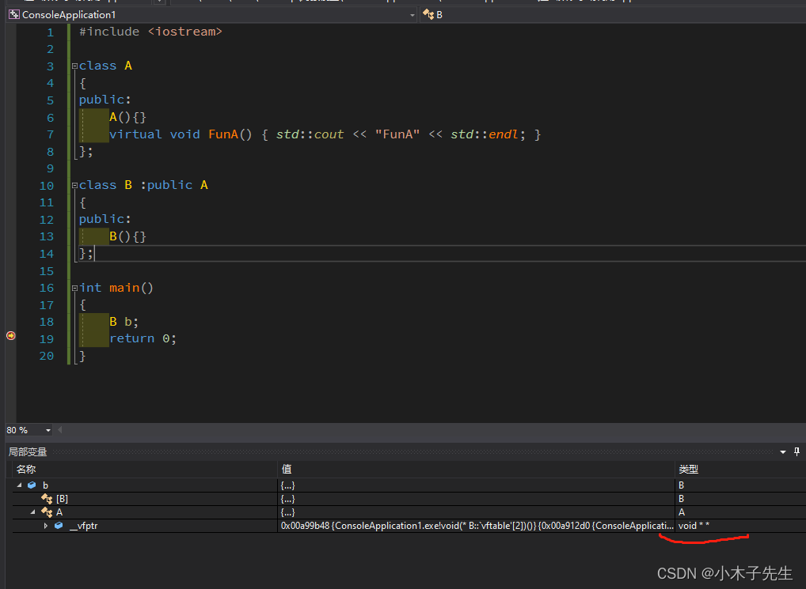
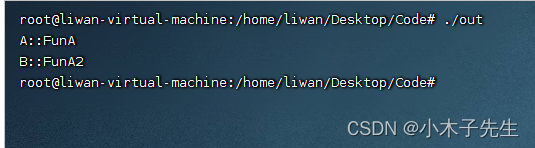

> 搬运来源：CSDN · 小木子先生（HELLO_LW）
> 原文地址：https://blog.csdn.net/HELLO_LW/article/details/131160339

# 虚函数表手动调用

## 虚函数表手动调用

如果不了解vptr的位置关系的话想使用vptr来调用虚函数还是有一些困难的，前面已经说过了位置关系，现在来手动调用一下。

## vptr是一个二维数组

验证这一点也很简单，debug一下，看一下数据类型就清楚了  


## 通过转换取到vftable

```cpp
#include <iostream>

class A
{
public:
	A(){}
	virtual void FunA() { std::cout << "A::FunA" << std::endl; }
	virtual void FunA2() { std::cout << "A::FunA2" << std::endl; }
};

class B :public A
{
public:
	B(){}
	virtual void FunA2() { std::cout << "B::FunA2" << std::endl; }
};

int main()
{
	A *a = new B();
	long* vptrs = (long*)a;
	long* vptr = (long*)*vptrs;	//这一步已经取到了虚函数表

	typedef void(*Fun)(void);
	Fun vptrFunA = (Fun)vptr[0];
	Fun vptrFunA2 = (Fun)vptr[1];
	vptrFunA();
	vptrFunA2();

	return 0;
}
```

输出：  
A::FunA  
B::FunA2  
与我们猜想的完全正确，说明我们取到了虚函数表  
在Linux下使用G++跑一遍  
  
效果是一模一样的！
