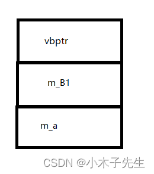
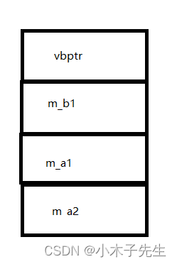
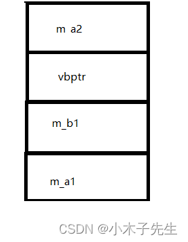
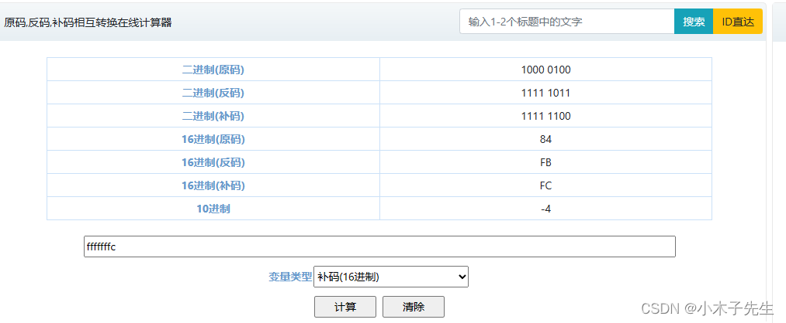
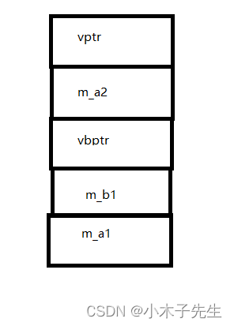
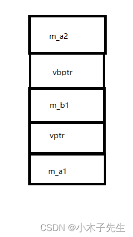

> 搬运来源：CSDN · 小木子先生（HELLO_LW）
> 原文地址：https://blog.csdn.net/HELLO_LW/article/details/131273074

# 虚继承菱形继承第二层vbtable分析

## 虚继承之菱形继承第二层vbtable分析

## 单虚继承无虚函数

```cpp
#include <iostream>
#include <cstdio>

class A1
{
public:
	A1()
	{
		printf("A的this=%p\n", this);
	}
public:
	int m_a;
};

class B1 : virtual public A1
{
public:
	B1()
	{
		printf("B1的this=%p\n", this);
	}
public:
	int m_B1;
};
int main()
{
	B1 b;
	b.m_a = 1;
	b.m_B1 = 2;
	return 0;
}
内存：
0x00BBFEC4  40 8c 3a 00 02 00 00 00 01 00 00 00
```

### 内存模型



### 进入vbtable

```cpp
内存：
0x00238C40  00 00 00 00 08 00 00 00
```

这就是vbptr所指向的虚函数表，是占8个字节的,前面四个为0，后面四个为8

### 汇编

```cpp
b.m_a = 1;
00232ECC  mov         eax,dword ptr [b]  		//获得vbptr的内容也就是vbtable 0x00238C40
00232ECF  mov         ecx,dword ptr [eax+4]  	//vbtable偏移4个字节，也就是是08 00 00 00
00232ED2  mov         dword ptr b[ecx],1 		//b的起始位置偏移8个字节 也就是m_a的位置
```

### 分析

后面四个字节8是偏移量，代表从头指针偏移8个字节就可以到m_a变量了，所以vbtable存储的是m_a的偏移量  
虚函数表最少占用8个字节

## 多虚继承无虚函数

```cpp
#include <iostream>
#include <cstdio>

class A1
{
public:
	A1()
	{
		printf("A1的this=%p\n", this);
	}
public:
	int m_a1;
};

class A2
{
public:
	A2()
	{
		printf("A2的this=%p\n", this);
	}
public:
	int m_a2;
};

class B1 : virtual public A1, virtual public A2
{
public:
	B1()
	{
		printf("B1的this=%p\n", this);
	}
public:
	int m_b1;
};

int main()
{
	B1 b;
	b.m_a1 = 1;
	b.m_b1 = 2;
	b.m_a2 = 3;
	std::cout << sizeof(B1) << std::endl;
	return 0;
}
输出：
A1的this=007CFCD8
A2的this=007CFCDC
B1的this=007CFCD0
16
内存：
0x007DF920  4c 8c 9c 00 02 00 00 00 01 00 00 00 03 00 00 00	//头地址可能有误，重新运行过
```

多虚继承只有一个vbptr可见，多虚继承共用一个虚基类表

### 内存模型



### 进入vtable

```cpp
vbtable内存
0x009C8C4C  00 00 00 00 08 00 00 00 0c 00 00 00
```

### 汇编

```cpp
	b.m_a1 = 1;
009C2FFC  mov         eax,dword ptr [b]        //获取虚vbtable eax=4c 8c 9c 00
009C2FFF  mov         ecx,dword ptr [eax+4]  	// vbtable偏移4个 08 00 00 00 ecx=8
009C3002  mov         dword ptr b[ecx],1 		//b偏移8个，将1的值赋给它
	b.m_a2 = 3;
009C3011  mov         eax,dword ptr [b]  		//获取虚vbtable eax=4c 8c 9c 00
009C3014  mov         ecx,dword ptr [eax+8]  	// vbtable偏移4个字节 0c 00 00 00 ecx=0c(H)
009C3017  mov         dword ptr b[ecx],3		//b偏移0c(H)个字节，将3的值赋给它
```

### 分析

现在vbtable是12个字节了，第4-7字节存放8，第8-11字节存放12，8对应着m_a1到对象头的偏移距离，12对应着m_a2到对象头的偏移距离  
多虚继承共用一个vbtable

## 单虚继承单非虚继承无虚函数

```cpp
#include <iostream>
#include <cstdio>

class A1
{
public:
	A1()
	{
		printf("A1的this=%p\n", this);
	}
public:
	int m_a1;
};

class A2
{
public:
	A2()
	{
		printf("A2的this=%p\n", this);
	}
public:
	int m_a2;
};

class B1 : virtual public A1, public A2
{
public:
	B1()
	{
		printf("B1的this=%p\n", this);
	}
public:
	int m_b1;
};

int main()
{
	B1 b;
	b.m_a1 = 1;
	b.m_b1 = 2;
	b.m_a2 = 3;
	std::cout << sizeof(B1) << std::endl;
	return 0;
}
输出
A1的this=003CF8C8
A2的this=003CF8BC
B1的this=003CF8BC
16
内存
0x003CF8BC  03 00 00 00 4c 8c ce 00 02 00 00 00 01 00 00 00
```

### 内存模型



### 进入vtable

```cpp
0x00CE8C4C  fc ff ff ff 08 00 00 00
```

可以看见，跟以往不同的是前面四个字节也有了空间，根据补码转换器，是-4，负数在计算机中是用补码的方式表示的  
  
应该是vbptr向后退4个到达起始地址，像后面走8个到达的m_a1地址

### 汇编

```cpp
00CE2FFC  mov         eax,dword ptr [ebp-14h]  //ebp应该是结束符 - 14h刚刚好就到了 vbptr的位置4c 8c ce 00
00CE2FFF  mov         ecx,dword ptr [eax+4]  // vbtable偏移4个字节
00CE3002  mov         dword ptr [ebp+ecx-14h],1  //计算偏移值 将1赋值给m_a1,这里跟之前计算偏移值有些区别
```

### 分析

vbptr存储是4-7个字节中，所以虚继承的内存是在普通继承的后面  
vbtable的前4个字节存储的是-4，那么对应的是应该是vbptr到首地址的偏移量，后四个字节存储的是8，对应着m_a1到vbptr的偏移量  
根据汇编代码可以看到，vbtable的前四个字节是用来做差运算得到vbptr的位置，ebp是结尾地址，14h应该就是差值后的结果

## 单虚继承单非虚继承虚函数在普通继承

```cpp
#include <iostream>
#include <cstdio>

class A1
{
public:
	A1()
	{
		printf("A1的this=%p\n", this);
	}
public:
	int m_a1;
};

class A2
{
public:
	A2()
	{
		printf("A2的this=%p\n", this);
	}
	virtual void A2Func() {}
public:
	int m_a2;
};

class B1 : virtual public A1, public A2
{
public:
	B1()
	{
		printf("B1的this=%p\n", this);
	}
public:
	int m_b1;
};

int main()
{
	B1 b;
	b.m_a1 = 1;
	b.m_b1 = 2;
	b.m_a2 = 3;
	std::cout << sizeof(B1) << std::endl;
	return 0;
}
输出：
A1的this=00EFFA04
A2的this=00EFF9F4
B1的this=00EFF9F4
20
内存：
0x00EFF9F4  70 8c 10 00 03 00 00 00 38 8c 10 00 02 00 00 00 01 00  p?......8?........
0x00EFFA06  00 00
```

### 内存模型



### 进入vbtable

```cpp
0x00108C38  f8 ff ff ff 08 00 00 00
```

### 分析

跟上种情况一样，只是多了个虚函数表

## 单虚继承单非虚继承虚函数在虚继承

```cpp
#include <iostream>
#include <cstdio>

class A1
{
public:
	A1()
	{
		printf("A1的this=%p\n", this);
	}
	virtual void A1Func() {}
public:
	int m_a1;
};

class A2
{
public:
	A2()
	{
		printf("A2的this=%p\n", this);
	}
public:
	int m_a2;
};

class B1 : virtual public A1, public A2
{
public:
	B1()
	{
		printf("B1的this=%p\n", this);
	}
public:
	int m_b1;
};

int main()
{
	B1 b;
	b.m_a1 = 1;
	b.m_b1 = 2;
	b.m_a2 = 3;
	std::cout << sizeof(B1) << std::endl;
	return 0;
}
输出：
A1的this=006FFC24
A2的this=006FFC18
B1的this=006FFC18
20
内存：
0x006FFC18  03 00 00 00 38 8c 08 00 02 00 00 00 70 8c 08 00 01 00  ....8?......p?....
0x006FFC2A  00 00
```

### 内存模型



### 进入tbtable

```cpp
0x00088C38  fc ff ff ff 08 00 00 00
```

### 汇编

```cpp
000830DC  mov         eax,dword ptr [ebp-18h]  
000830DF  mov         ecx,dword ptr [eax+4]  
000830E2  mov         dword ptr [ebp+ecx-14h],1
```

### 分析

这里我个人感到很奇怪的是tbtable后四个字节竟然不是12，而是8，但是根据汇编她还是把vptr的四个字节剪掉了

## 虚函数在子类

结果跟虚函数在普通继承一样的，因为他们共用同一个this指针
