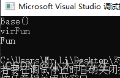
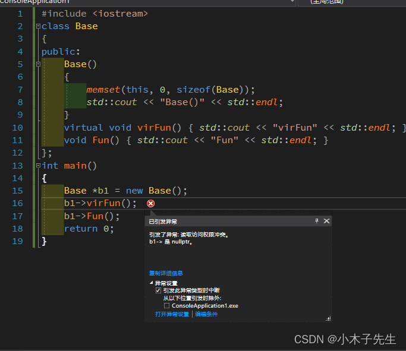
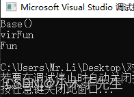
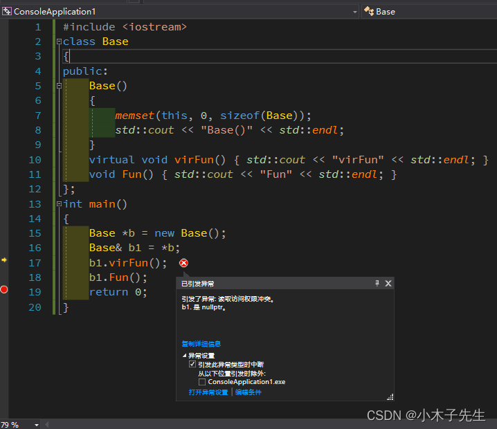

> 搬运来源：CSDN · 小木子先生（HELLO_LW）
> 原文地址：https://blog.csdn.net/HELLO_LW/article/details/131198191

# 静态联编和动态联编

## 静态联编和动态联编

静态联编就是在编译的时候就已经确定了调用哪个函数，动态联编就是在运行期间才能确定调用了哪个函数。下面实践一下！

## 静态联编

动态联编调用函数是依靠虚函数表的，那么我们把虚函数表去掉，看一下函数是否还能运行。

```cpp
#include <iostream>
class Base
{
public:
	Base()
	{
		memset(this, 0, sizeof(Base));
		std::cout << "Base()" << std::endl;
	}
	virtual void virFun() { std::cout << "virFun" << std::endl; }
	void Fun() { std::cout << "Fun" << std::endl; }
};
int main()
{
	Base b1;
	b1.virFun();
	b1.Fun();
	return 0;
}
```

在构造函数中，使用memset把vptr的值清空掉，这样它就调用不到虚函数表了，然后再去调用虚函数，看到执行结果：  
  
正常执行是没有问题的，他不是一个多态，所以是静态联编。

### 静态反汇编

看一下汇编语言

```cpp
	Base b1;
00A92952  lea         ecx,[b1]  
00A92955  call        Base::Base (0A912EEh)  
	b1.virFun();
00A9295A  lea         ecx,[b1]  
00A9295D  call        Base::virFun (0A91177h)  
	b1.Fun();
00A92962  lea         ecx,[b1]  
00A92965  call        Base::Fun (0A9135Ch) 
```

可以看到是直接调用的函数，怎么执行早就被固定的死死的。

## 动态联编

多态都是使用的动态联编，将代码进行一个简单的改造

```cpp
#include <iostream>
class Base
{
public:
	Base()
	{
		memset(this, 0, sizeof(Base));
		std::cout << "Base()" << std::endl;
	}
	virtual void virFun() { std::cout << "virFun" << std::endl; }
	void Fun() { std::cout << "Fun" << std::endl; }
};
int main()
{
	Base *b1 = new Base();
	b1->virFun();
	b1->Fun();
	return 0;
}
```

这段代码是跑不通的，会报异常，因为在堆取创建是一个多态但是在构造函数中把虚函数表给清空了，找不到vptr了  
  
把memset注释掉，再来运行，就成功了  


### 动态反汇编

```cpp
	Base *b1 = new Base();
00142967  push        4  
00142969  call        operator new (01413ACh)  
0014296E  add         esp,4  
00142971  mov         dword ptr [ebp-0ECh],eax  
00142977  mov         dword ptr [ebp-4],0  
0014297E  cmp         dword ptr [ebp-0ECh],0  
00142985  je          main+7Ah (014299Ah)  
00142987  mov         ecx,dword ptr [ebp-0ECh]  
0014298D  call        Base::Base (01412EEh)  
00142992  mov         dword ptr [ebp-0F4h],eax  
00142998  jmp         main+84h (01429A4h)  
0014299A  mov         dword ptr [ebp-0F4h],0  
001429A4  mov         eax,dword ptr [ebp-0F4h]  
001429AA  mov         dword ptr [ebp-0E0h],eax  
001429B0  mov         dword ptr [ebp-4],0FFFFFFFFh  
001429B7  mov         ecx,dword ptr [ebp-0E0h]  
001429BD  mov         dword ptr [b1],ecx  
	b1->virFun();
001429C0  mov         eax,dword ptr [b1]  
001429C3  mov         edx,dword ptr [eax]  
001429C5  mov         esi,esp  
001429C7  mov         ecx,dword ptr [b1]  
001429CA  mov         eax,dword ptr [edx]  
001429CC  call        eax  
001429CE  cmp         esi,esp  
001429D0  call        __RTC_CheckEsp (01412DFh)  
	b1->Fun();
001429D5  mov         ecx,dword ptr [b1]  
001429D8  call        Base::Fun (014135Ch)  
```

可以看见构造函数和virFun都变得特别多，这就是动态绑定，Fun跟之前一样，因为他是一个非虚函数，不需要通过vptr去调用。

### 引用实现动态联编

除了指针可以实现动态联编，引用也可以

```cpp
#include <iostream>
class Base
{
public:
	Base()
	{
		memset(this, 0, sizeof(Base));
		std::cout << "Base()" << std::endl;
	}
	virtual void virFun() { std::cout << "virFun" << std::endl; }
	void Fun() { std::cout << "Fun" << std::endl; }
};
int main()
{
	Base *b = new Base();
	Base& b1 = *b;
	b1.virFun();
	b1.Fun();
	return 0;
}
```

  
可以看见效果跟指针是一模一样的！
