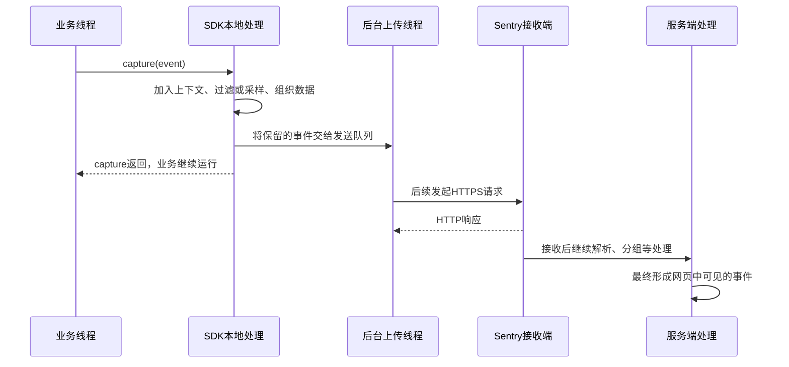

# 第一篇：Sentry 是什么，它怎样把一次崩溃变成可排查的问题

> 面向第一次系统学习 Sentry 的 C++ / CEF 开发者。资料核对日期：2026-10-18。推荐阅读顺序：本文 → [崩溃与堆栈原理](04-崩溃现场与堆栈还原原理.md) → [C++ 接入](02-C++程序接入Sentry.md) → [CEF 接入](03-CEF程序接入Sentry.md)。

## 1. 先从一个工作场景理解

用户说：“点了打开文件，软件直接退出了。”你本地却一直复现不了。

你需要知道：哪个版本、哪个系统、哪个线程、执行到哪个函数、崩溃之前做了什么，以及多少用户遇到了同一个问题。Sentry 就是帮助团队集中收集、整理和追踪这些信息的错误监控平台。你在程序中接入 SDK，程序把错误信息发送到 Sentry，开发者在网页上分析和处理。

Sentry 可以上报程序没有退出的业务错误，也可以处理原生程序崩溃；性能追踪等能力可以以后再学。本系列先把“采集 → 上传 → 看懂堆栈 → 修复验证”这条链路讲清楚。

日志适合记录程序的运行细节；Sentry 则把错误组织成可以持续处理的问题。两者通常一起使用。例如日志记录文件加载过程，Sentry 用 breadcrumbs 记录少量关键步骤，并在加载失败时生成事件。

## 2. 这些术语会反复出现

| 术语 | 通俗解释 | 例子 |
| --- | --- | --- |
| Organization | 团队的管理空间 | 公司或研发团队 |
| Project | 接收一类应用事件的项目 | desktop-native、desktop-web |
| SDK | 集成到应用里的采集库 | sentry-native、@sentry/browser |
| DSN | 告诉 SDK 把事件发到哪里 | 项目设置中的接收地址 |
| Event | 某一次具体的错误记录 | 张三今天发生的一次崩溃 |
| Issue | 被归为同类问题的一组事件 | 多位用户命中的同一个缺陷 |
| Release | 应用版本标识 | desktop-demo@1.0.0 |
| Environment | 运行环境 | development、staging、production |
| Tag | 便于筛选的字段 | channel=beta |
| Breadcrumb | 错误发生前的关键操作轨迹 | 打开窗口 → 选择文件 → 开始解析 |
| Debug information file | 把机器地址解释成代码位置的调试文件 | PDB、dSYM、ELF 调试信息 |
| Minidump | 崩溃时保存的进程状态片段 | 线程、寄存器、模块、部分内存 |

DSN 常见外观如下，实际应从项目设置复制：

```text
https://PUBLIC_KEY@INGEST_HOST/PROJECT_ID
```

DSN 是客户端接收配置，不等同于拥有项目管理权限的 Auth Token。上传符号所用的 Token 应保存在构建机或 CI 的密钥配置中，不要放进客户端。

## 3. 普通错误怎样上报

### 3.1 “普通错误”指什么

例如读配置失败，程序显示提示后仍能继续运行。此时你可以在正常业务代码里调用：

```cpp
sentry_capture_event(sentry_value_new_message_event(
    SENTRY_LEVEL_ERROR, "config", "Failed to load configuration"));
```

这段代码的意思是：“创建一条错误事件，交给 SDK 处理。”它不是要求操作系统制造一次崩溃，也不需要先生成 dump。

“采集”和“上传”是两个步骤。以 SDK 默认的异步网络上传为例：



这是常见默认传输的示意；本地处理可能与后台执行重叠，自定义 transport 也可以改变行为。关键是：**capture 这个函数通常不会等到服务端完成接收和处理才返回。**

### 3.2 为什么 capture 返回不等于上传成功

看一个假设的时间线：

```text
00 ms  业务调用 capture
01 ms  SDK 为事件准备数据并交给发送队列
02 ms  capture 返回，业务线程继续
10 ms  后台线程准备连接 Sentry
11 ms  进程被强制结束，请求尚未完成
```

这里 capture 确实返回了，但 Sentry 没收到事件。如果本地持久化机制在此前成功保存了它，后续可能还有发送机会；如果没有，就可能丢失。持久化和重试必须按具体配置验证，不能从 capture 返回这一事实推出。

即使进程没有结束，还可能出现 DNS 失败、TLS 失败、断网、服务端限流或事件被过滤等情况。函数已经返回，后面的网络结果不会“倒过来修改”那次返回值。

`sentry_capture_event()` 返回的事件 ID 用于标识和关联事件，不是服务器送达回执；拿到 ID 也不能证明网页上已有事件。

可以把过程分成四个检查点：

| 检查点 | 能说明什么 | 还不能说明什么 |
| --- | --- | --- |
| capture 返回 | 本地调用结束 | 请求已经发送成功 |
| 本地报告或队列中有数据 | 数据在本地存在 | 服务端已经收到 |
| 接收端成功响应 | 对应请求在接收层得到成功响应 | 网页已完成处理、符号一定齐全 |
| 网页能找到目标事件 | 端到端可见性已经验证 | 所有用户、进程和故障路径都被覆盖 |

短命测试程序通常应在正常退出前调用 `sentry_flush(timeout)` 并正常 `sentry_close()`，给后台任务时间。`flush` 等待的是传输队列工作完成或超时，不是查询网页事件是否可见；它也不能保证另一个 Crashpad handler 的崩溃报告上传完成。API 语义见 [sentry-native 官方头文件](https://github.com/getsentry/sentry-native/blob/master/include/sentry.h)。

### 3.3 为什么 catch 到的异常要主动上报

```cpp
try {
    LoadConfig();
} catch (const std::exception& e) {
    // 程序已接住错误，还在正常运行；由业务决定是否上报。
    sentry_capture_event(sentry_value_new_message_event(
        SENTRY_LEVEL_ERROR, "config", e.what()));
}
```

SDK 的崩溃采集机制通常不会因为这次已经被处理的异常而生成崩溃报告。另一个细节是：这条消息不会自动拥有异常最初抛出位置的堆栈。主动消息上报与原生崩溃现场采集是两条不同路径。

## 4. 原生崩溃为什么更复杂

访问无效内存、栈溢出或 `abort()` 可能让程序立刻终止。此时程序内部的锁、堆内存乃至运行库都可能不可靠。不能把崩溃处理想象成“在最后一个 catch 里打印日志，再发 HTTP”。

以采用 Crashpad 后端的 sentry-native 为例：

```text
应用正常运行时：SDK 安装采集机制、准备上下文和独立 handler
                            ↓
应用发生崩溃 → 崩溃处理机制通知 handler
                            ↓
                  采集并写入 minidump
                            ↓
                  按后端机制安排上传
                            ↓
Sentry 解析 dump → 展开调用栈 → 用符号解释地址 → 展示事件
```

Crashpad 是崩溃采集组件，Sentry 负责更完整的事件处理和问题管理；二者的职责不同。Native SDK 可以选择不同后端，本系列为了方便理解明确使用 Crashpad。后端支持范围和平台要求以选定版本的 [sentry-native 官方说明](https://github.com/getsentry/sentry-native) 为准。

本地报告与上传时机受后端、平台和网络状态影响。集成后应分别验证“发生崩溃是否生成报告”和“报告是否成功到达服务端”，不能只看初始化返回值。

## 5. 为什么堆栈里全是地址

编译后机器执行的是指令地址。例如：

```text
MyApp.exe + 0x18A40
```

符号化后才可能看到：

```text
DocumentParser::Parse()  parser.cpp:128
```

符号化需要崩溃报告中的模块标识与调试文件匹配。Windows 通常使用 PDB，macOS 使用 dSYM，Linux 使用带调试信息的 ELF 或对应的独立调试文件。

**同一个版本名称不代表同一次构建。** 重新编译的 `1.0.0` 可能已经无法匹配用户机器上的旧二进制。应把发布包、调试文件、提交号和构建标识一起归档，并在发布前上传对应符号。具体命令见第二篇。

有符号也不保证每一帧都有源码行号：优化、内联、栈损坏和第三方库符号缺失都会限制结果。符号文件中的源码路径，也不意味着服务端已经拥有源码内容。上传源码上下文需要另外配置。参见 [官方调试文件说明](https://docs.sentry.io/cli/dif/)。

## 6. Event 如何归成 Issue

Sentry 会根据错误类型、堆栈等信息进行分组；具体算法和配置可能随平台与版本不同。同一个 Issue 下可以有很多次 Event。

遇到一个高频 Issue 时，建议按以下顺序阅读：

1. 看环境和版本，确认是否来自生产以及是否集中于新版本。
2. 看异常类型和崩溃线程，找出最接近业务逻辑的相关帧。
3. 看 breadcrumbs 和上下文，推断触发路径。
4. 比较不同事件的共同点，例如系统版本、功能入口和渠道。
5. 结合源码、日志和本地调试验证假设。

堆栈给出的是“在哪里倒下”，根因可能更早发生。例如野指针访问崩在绘制函数，错误却来自之前的对象释放。

不要一开始就给所有错误设置相同 fingerprint 强制分组，否则会把不同缺陷揉在一起。

## 7. 能收集什么，不应期待什么

| 情况 | 应怎样理解 |
| --- | --- |
| 已捕获的业务异常 | 在正常执行路径主动 capture |
| 支持范围内的原生崩溃 | 由已初始化的崩溃采集机制处理 |
| 卡死或死锁 | 不一定触发崩溃机制，需另外检测 |
| 强制结束进程、断电、某些 OOM 终止 | 不能保证有崩溃报告 |
| CEF 页面 JavaScript 抛错 | 用网页 JS SDK，原生 dump 不负责提供 JS 错误详情 |
| 初始化之前的崩溃 | 该 SDK 尚未建立采集能力 |

SDK 不是自动修复器，也无法保证任何一次退出都有完整堆栈。

## 8. 上下文应该怎么设计

可以记录：应用版本、发布渠道、功能入口、操作阶段、匿名关联 ID。把稳定且便于筛选的分类放进 tags；把复杂详情放进上下文；用 breadcrumbs 记录有限数量的关键步骤。

不要把密码、Token、完整文件内容或带敏感参数的 URL 放入字段。Minidump 包含部分内存，本身也可能带出敏感信息；不能认为“字段脱敏了，dump 就一定没有敏感内容”。[官方 Minidump 文档](https://docs.sentry.io/platforms/native/guides/minidumps/)说明了它包含的状态类型。

另外，不要假定 `before_send` 在所有硬崩溃路径都会执行。平台和后端可能绕过进程内回调，重要的采集边界应在数据产生时落实。

## 9. 为什么主进程接入成功，不代表 CEF 子进程都被覆盖

### 9.1 进程之间不是共用一个 SDK 实例

假设 CEF 应用启动了这些进程：

```text
MyApp.exe                 PID 100：Browser 主进程
MyApp.exe --type=renderer PID 200：Renderer 子进程
MyApp.exe --type=gpu-process PID 300：GPU 子进程
```

它们即使使用同一个 EXE，也是三个独立的运行实例，各自有地址空间、线程、堆栈和运行状态。在 PID 100 中运行的初始化代码、设置的 tags 和维护的发送队列，不能默认视为 PID 200、300 中也已经生效。

例如 PID 200 访问无效地址时，错误发生在 PID 200 的线程里。PID 100 中安装的进程内异常处理入口，不会仅因为“我是父进程”就变成 PID 200 的异常处理入口。

### 9.2 独立 handler 能管多个进程，但需要建立采集关系

Crashpad handler 确实可以服务多个进程；前提是这些进程通过注册、平台支持的继承或 CEF 自身的初始化流程与它建立了正确关系。有的平台可以继承部分设置，因此也不是要求所有平台都手工逐进程启动一个 handler。

```text
Browser  ── 已接入 ──→ handler：Browser 崩溃能采集
Renderer ── 未确认 ──→ ?      ：Renderer 崩溃是否能采集，还不知道
GPU      ── 未确认 ──→ ?      ：GPU 崩溃是否能采集，还不知道
```

“主进程测试成功”只证明第一条链路有效；并没有证明后两条。CEF 自带机制可以负责子进程的接入，但仍需核对当前版本、启动入口、subprocess/Helper 路径、沙箱和打包方式。

### 9.3 收到退出通知不等于拿到了子进程堆栈

Renderer 崩溃后，Browser 可能收到 `OnRenderProcessTerminated` 通知。这相当于知道“PID 200 退出了”，不等于拥有 PID 200 崩溃瞬间的寄存器和栈内存。

如果你在这个回调里抓取当前堆栈，拿到的是 Browser 正在处理通知的调用链。要得到 Renderer 的崩溃堆栈，必须采集 Renderer 当时的现场。

因此应分别触发 Browser、Renderer、GPU 崩溃，并核对每条报告的进程信息。具体配置见 [CEF 接入篇](03-CEF程序接入Sentry.md)。

## 10. 接下来怎么读

如果想先弄清“程序已经崩了，堆栈究竟从哪来”，建议先读新增的 [第四篇：崩溃现场、堆栈还原与上传时序](04-崩溃现场与堆栈还原原理.md)，再看 [C++ 接入篇](02-C++程序接入Sentry.md) 和 [CEF 接入篇](03-CEF程序接入Sentry.md)。
