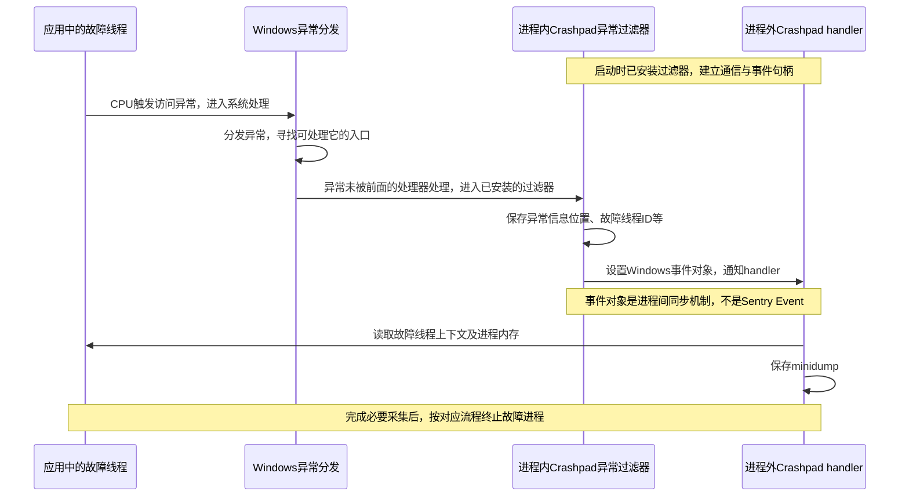
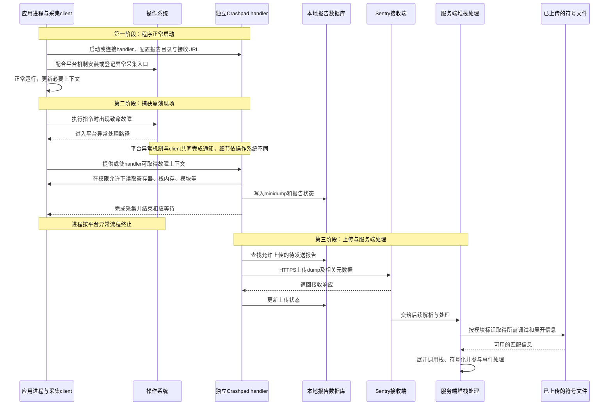
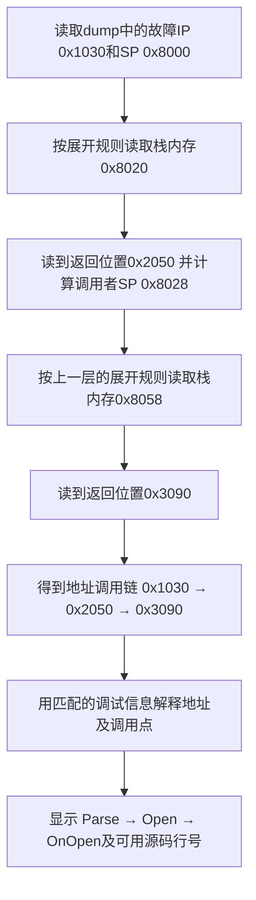
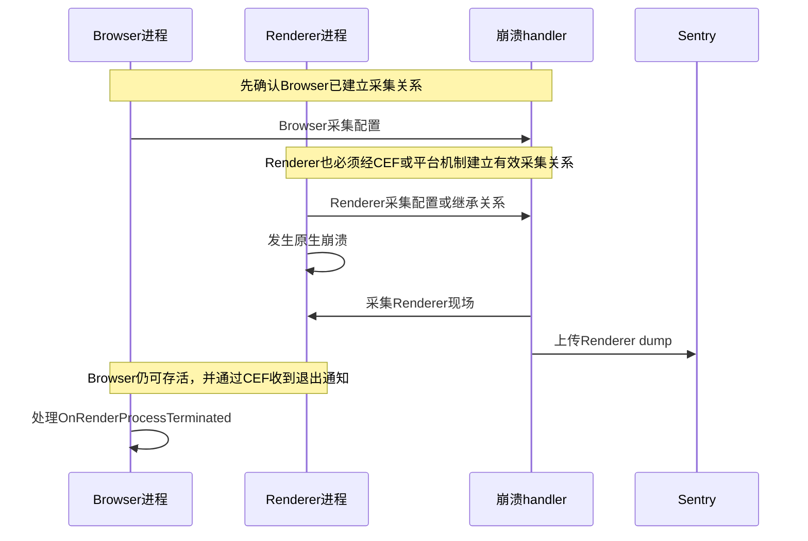

# 第四篇：程序崩溃时，堆栈究竟是怎样拿到的

> 这篇补足接入代码背后的核心原理。建议在[第一篇](01-Sentry是什么与工作原理.md)之后阅读，再结合 [C++ 接入](02-C++程序接入Sentry.md)与 [CEF 接入](03-CEF程序接入Sentry.md)动手。
>
> 资料核对日期：2026-10-18。本文以桌面原生程序、Crashpad 后端和服务端还原堆栈为主。时序图是概念流程，不是每个平台逐条 API 的执行记录；具体细节由操作系统、CEF 和 SDK 版本决定。

## 1. 先记住：保存现场、展开调用栈、符号化是三个步骤

你在 Sentry 网页上看到：

```text
DocumentParser::Parse()  parser.cpp:128
Document::Open()         document.cpp:56
MainWindow::OnOpen()     main_window.cpp:92
```

这通常经过了以下过程：

```text
崩溃时的寄存器、线程栈内存、模块信息
       ↓ 保存现场
minidump 文件
       ↓ 展开调用栈（stack walking / unwinding）
一组指令地址，以及它们所属的模块
       ↓ 符号化（symbolication）
函数名、源码文件、行号，以及可能的内联帧
```

不要把“拿到 dump”“拿到完整地址调用链”“拿到有源码行号的堆栈”理解成同一件事。前一步成功，后一步仍可能失败。

## 2. 程序运行时，“调用栈”在哪里

### 2.1 一个线程有自己的栈

假设代码按这个顺序调用：

```cpp
void Parse() { /* 这里发生无效内存访问 */ }
void Open() { Parse(); }
void OnOpen() { Open(); }
```

CPU 执行调用时，需要保留“被调用函数结束后回到哪里”等状态。在典型的 x86/x64 调用中，返回地址与栈有关；其他架构也可能先使用链接寄存器，再按需保存到栈。编译器还会安排参数、局部变量和保存的寄存器。

可以先把它想成下面的示意，而不是固定的真实内存布局：

```text
线程当前正在执行 Parse

寄存器：
  IP / PC：当前执行的指令地址
  SP     ：当前栈顶位置
  FP     ：某些编译配置下用于连接栈帧的指针

线程栈中的部分内容：
  Parse 的局部状态、保存的寄存器等
  返回 Open 的地址
  Open 的局部状态、保存的寄存器等
  返回 OnOpen 的地址
  ……
```

栈里通常没有一个现成的字符串数组 `{"Parse", "Open", "OnOpen"}`。函数名、文件和行号主要来自二进制及其调试信息。

### 2.2 为什么不能简单顺着 FP 一直找

编译优化可能省略帧指针、内联函数或进行尾调用；返回地址的位置也受函数序言、栈分配和当前执行位置影响。因此展开器常需要编译器产生的 **unwind information（栈展开信息）**，根据规则计算调用者的寄存器和栈位置。

例如 Windows x64 的运行时函数表和展开数据告诉展开器如何撤销当前函数对栈和寄存器的调整；相关信息常涉及 `.pdata` 和 `.xdata`。Linux 等环境常使用 DWARF CFI 等机制。它们解决“怎样回到上一层”，而调试符号进一步解决“这个地址叫什么、对应哪一行”。参见 [Microsoft 的 x64 异常处理说明](https://learn.microsoft.com/en-us/cpp/build/exception-handling-x64?view=msvc-170)。

这也解释了：**没有 PDB 不等于一定一帧也展不开；有 PDB 也不等于损坏的栈一定能完整恢复。**

## 3. 崩溃发生时，谁先知道

以一次访问无效地址为例：

1. CPU 执行访问指令时发现异常条件，交由操作系统处理。
2. 操作系统根据平台机制传递异常；并非每一次异常都意味着程序必然退出。
3. 当异常进入已安装的崩溃处理路径时，采集机制保留故障线程的异常上下文，并协调 handler 采集现场。
4. 完成必要采集后，进程按对应异常处理流程终止。

平台机制不同：Windows 涉及异常分发和进程内异常处理入口；macOS 使用 Mach exception 等机制；Linux 的 Crashpad 通常涉及致命信号、通信通道与受权限控制的跨进程采集。不能把 Windows 的异常处理函数名直接套到其他系统。

C++ 的 `try/catch` 主要用于语言层面的异常，不能当成跨平台捕获任意原生崩溃的统一入口。栈溢出、fast-fail 等路径还可能有特殊处理要求。

### 3.1 handler 为什么会“自动”捕获？是谁通知它？

这里的“自动”来自**初始化时提前安装好的异常处理入口与通信机制**。handler 通常等待通知，不是不断轮询“哪个进程崩了”。

以 Windows 的常规未处理异常路径为例，先区分两个对象：应用进程内有 Crashpad client；应用进程外有 Crashpad handler。

程序启动、初始化 Crashpad 时，client 会建立与 handler 的联系，并安装未处理异常过滤器（Unhandled Exception Filter）。你可以将这个过滤器理解为：预先交给系统的一段回调代码，当异常走到这个处理阶段时，系统就会调用它。

发生无效内存访问后，典型流程如下：



所以，“谁通知 handler”的直接答案是：**Windows 这条常规路径中，操作系统先把异常分发给应用内预先安装的 Crashpad 过滤器，再由过滤器通过 Windows 事件对象通知独立 handler。** 这个过滤器运行在故障进程内，并不是另一条永远健康的业务线程。

这是典型路径，不能覆盖所有终止方式：异常若先被其他处理器接住，就可能不会到达这里；fast-fail、栈损坏等也可能需要专门支持或使该路径不可用。这里不是要求你自己编写或覆盖这个过滤器，Crashpad 集成负责安装它。

不同平台的通知方式如下：

| 平台 | 典型的通知链 |
| --- | --- |
| Windows | 系统分发异常 → 进程内过滤器 → 设置事件对象 → handler 被唤醒 |
| Linux | 系统投递致命信号 → 进程内信号处理函数 → 通过 socket 发请求 → handler 收到请求 |
| macOS | 初始化时登记 Mach 异常端口 → 内核将异常消息投递到该端口 → handler 接收消息 |

这些通知机制及平台差异可查 [Crashpad 官方设计文档的 Capturing Exceptions 部分](https://chromium.googlesource.com/crashpad/crashpad/+/HEAD/doc/overview_design.md#capturing-exceptions)。

**采集关系没建立、异常入口被覆盖或 handler 没能启动，就不能期待这条通知链自动成立。** 这也是 CEF 每个进程的覆盖情况都需要验证的原因。

### “崩溃了”为什么还能读取内存

日常说“程序崩了”，往往把“出现致命故障”与“进程已彻底销毁”混为一谈。

Crashpad 要在进程地址空间仍可读取的阶段完成采集。根据平台机制，故障线程会等待采集完成，其他线程可能被暂停或按采集流程控制；handler 在这段窗口中读取所需状态。完成现场保存后，进程才继续走终止流程。

**不是进程彻底消失后，handler 还能凭空读回已经释放的栈。** 如果强制终止绕过了可用采集路径，或者现场来不及保存，就可能没有报告。

## 4. Crashpad 的 client 和 handler 分别做什么

| 组件 | 在哪里运行 | 主要职责 |
| --- | --- | --- |
| Crashpad client | 被监控的应用进程内 | 建立采集关系、配置异常入口、提供元数据与必要通知 |
| Crashpad handler | 独立进程 | 读取现场、生成 dump、维护报告数据库并按配置上传 |
| sentry-native | 应用进程内的 SDK 及其集成代码 | 提供 Sentry API、上下文、配置和后端适配 |
| Sentry 服务端 | 远端服务 | 接收、解析、符号化、分组和展示 |

handler 是一个独立进程，所以应用堆损坏或应用里的锁出问题时，它有更好的机会继续工作。不过它依然需要正确的权限、有效的通信和可读取的现场，并非任何情况下都能成功。

一个 handler 可以服务多个已建立采集关系的进程，不要求“一进程一个 handler”。某些系统支持继承部分注册关系；其他场景需要显式连接。Crashpad 的[官方设计文档](https://chromium.googlesource.com/crashpad/crashpad/+/HEAD/doc/overview_design.md)说明了 client/handler 分工及各平台的注册机制。

## 5. 从启动到崩溃上报的完整时序

下面展示桌面 Crashpad 集成的概念流程。Native SDK 的附加上下文处理与 CEF 自带采集方式存在差异，但都需要在故障发生之前建立有效的采集链路。



图中阶段可能交叠，上传可能晚于应用终止，服务端展开和查找符号也可能交替进行。网络失败后的重试、退避与保留策略，应核对实际后端版本和配置；不能从这张图推导“报告永远不会丢”。

关键是：**崩溃进程退出之后，只要 dump 已可靠保存，后续解析就可以基于 dump 进行，不再要求原进程活着。**

## 6. Minidump 里具体保存什么

它可以包含以下信息，具体内容取决于平台与采集配置：

| 内容 | 用来解决什么问题 |
| --- | --- |
| 异常类型、故障地址、故障线程标识 | 哪个线程发生了什么故障 |
| 线程寄存器上下文 | 从什么指令地址和栈位置开始还原 |
| 各线程的栈内存 | 找调用者状态和返回地址 |
| 已加载模块、加载地址、模块标识 | 地址属于哪个 EXE/动态库，如何匹配符号 |
| 系统、CPU 架构和附加元数据 | 判断运行环境、解释采集数据 |

它通常不是完整内存镜像，也不是源码包，更不保证保存所有局部变量。优化后变量可能已经不存在，或位于未采集的内存中。[Sentry Minidump 文档](https://docs.sentry.io/platforms/native/guides/minidumps/)列出了常见内容和接收接口。

即使只采集部分内存，也可能包含敏感信息。应在采集设计时限制字段和内存范围，不能只依赖普通事件的发送前回调清理 dump 内容。

## 7. 服务端怎样把现场还原成堆栈

### 7.1 先看它最终要回答什么问题

假设有下面的调用。代码仅表达调用关系，具体地址和栈布局由编译器决定：

```cpp
void Parse() { /* 在这里发生原生崩溃 */ }
void Open() { Parse(); }
void OnOpen() { Open(); }
```

崩溃时，程序还没从 `Parse()` 返回。我们想知道的是：

```text
现在在哪？       Parse
谁调用了它？     Open
谁又调用了Open？ OnOpen
```

服务端没有运行你的程序，也没有录像。它只能读取 dump 保存的线索，逐层找出答案。

先不看模块基址、ASLR 等细节。下面只用一个**简化的 x64 栈模型**演示，假设没有内联、尾调用或栈损坏，地址都是虚构的十六进制数。

### 7.2 函数调用时，为什么会留下线索

当 `Open()` 调用 `Parse()` 时，CPU 后续还要知道：“Parse 执行完，回到 Open 的哪个位置继续？”

在 x64 的普通 `call` 调用中，会把**返回地址**压入线程栈。这里的返回地址，是 Open 中调用指令之后的位置，不是 Parse 的入口地址。

同样，`OnOpen()` 调用 `Open()` 时，也会留下一个返回 OnOpen 的地址。这些返回地址可能在崩溃时仍保留在栈内存中。

```text
OnOpen 调用 Open：保存“Open结束后，回到OnOpen的哪里”
Open 调用 Parse： 保存“Parse结束后，回到Open的哪里”
Parse 发生崩溃： 这些调用尚未正常返回，相关状态仍可能在栈里
```

**还原调用栈，就是从当前执行位置出发，逐层找这些调用者的返回位置。**

但是，栈里还有局部变量、临时数据和保存的寄存器，返回地址并不总在栈顶。所以还需要一份说明“去哪里读返回地址、怎样恢复上一层栈位置”的规则，也就是展开信息。

### 7.3 假设 dump 保存了这些数据

第一类是故障线程的寄存器值：

```text
IP = 0x1030    当前执行到的代码地址
SP = 0x8000    当前栈顶的内存地址
```

第二类是线程栈内存的一份副本：

| 栈内存地址 | 这个位置保存的值 | 为了教学，先标出其含义 |
| --- | --- | --- |
| 0x8000 ～ 0x801F | 若干数据 | Parse 使用的栈空间，共 0x20 字节 |
| 0x8020 | 0x2050 | Parse 结束后，返回 Open 的代码地址 |
| 0x8028 ～ 0x8057 | 若干数据 | Open 使用的栈空间，共 0x30 字节 |
| 0x8058 | 0x3090 | Open 结束后，返回 OnOpen 的代码地址 |

**左列是“从哪个内存位置读取”，中列是“读出来的值”。** 例如：从栈内存 `0x8020` 处读出 `0x2050`，意思是找到了一条指向代码的返回地址。

右列说明是我们为了教学添加的；真实 dump 的内存中没有“这是 Open 的返回地址”这句注释。分析器必须结合展开规则判断。

第三类是展开时可取得的规则。为了演示，假设它们可以简化成：

```text
对包含0x1030的当前函数：
  返回地址存放在 当前SP + 0x20 处
  恢复到调用者后，SP = 当前SP + 0x28

对包含0x2050的当前函数：
  返回地址存放在 当前SP + 0x30 处
  恢复到调用者后，SP = 当前SP + 0x38
```

这些规则来自构建产物中的展开信息，不是服务端猜出的固定常量，也不是每个函数都用同样的偏移。上面的 `0x28` 等于 `0x20 + 8`，其中 8 是此例中返回地址占用的字节数。

Windows x64 的展开信息记录函数对栈指针和寄存器做过的调整；真实规则还要考虑当前指令位置、保存的寄存器和函数序言等。参见 [Microsoft 官方说明](https://learn.microsoft.com/en-us/cpp/build/exception-handling-x64?view=msvc-170)。

### 7.4 第一步：从寄存器直接得到最内层的位置

```text
dump告诉我们：IP = 0x1030
所以第一帧的代码位置就是：0x1030
```

这一步还不需要知道函数叫 Parse。先记住“出事时执行到了地址 0x1030”。

### 7.5 第二步：找到是谁调用了当前函数

当前 `SP = 0x8000`。按当前函数的展开规则计算：

```text
返回地址存放位置 = SP + 0x20
                 = 0x8000 + 0x20
                 = 0x8020

读取dump里的栈内存：memory[0x8020] = 0x2050

于是找到了调用者的返回位置：0x2050
恢复后的调用者SP = 0x8000 + 0x28 = 0x8028
```

现在有两帧的位置了：

```text
0x1030 → 0x2050
当前函数   调用它的函数中的返回位置
```

这里的“恢复”是在分析器中计算一组虚拟的寄存器值，**不会让用户的程序真的返回或重新执行。** 分析器只是在读文件、做计算。

### 7.6 第三步：用同样的方法，再往上一层找

接下来以调用者的状态继续计算：

```text
当前代码位置 = 0x2050
当前SP       = 0x8028

查当前函数的展开规则：返回地址在 SP + 0x30 处

返回地址存放位置 = 0x8028 + 0x30 = 0x8058
读取dump里的栈内存：memory[0x8058] = 0x3090
恢复后的调用者SP = 0x8028 + 0x38 = 0x8060
```

现在得到：

```text
0x1030 → 0x2050 → 0x3090
```

这就是沿着调用关系逐层向外找的过程，称为**展开调用栈**。真实程序会继续做下去，直到到达可识别的栈末端，或因为数据缺失、损坏而无法可靠继续。

### 7.7 第四步：把地址翻译成函数名和源码位置

上面得到的还是地址。接下来，分析器利用模块信息选择与这次构建匹配的调试文件，查询这些位置对应的函数与行号。

用一张教学用的“查询结果表”表示：

| 找到的位置 | 匹配的调试信息可以解释为 |
| --- | --- |
| 故障指令 0x1030 | Parse，parser.cpp 中的故障位置 |
| 返回位置 0x2050 所对应的调用点 | Open，document.cpp 中调用 Parse 的位置 |
| 返回位置 0x3090 所对应的调用点 | OnOpen，window.cpp 中调用 Open 的位置 |

调用者的地址来自“调用之后的返回位置”，所以分析器通常需要做调用点归属处理，不能把它和故障指令地址完全一样看待；这里省略具体实现。

你最终在网页上看到的就是：

```text
#0 Parse()    parser.cpp:某行
#1 Open()     document.cpp:某行
#2 OnOpen()   window.cpp:某行
```

“把地址解释成函数名和源码位置”叫**符号化**。展开需要知道“上一层在哪”，符号化需要知道“这个位置叫什么”。实际处理时，获取调试文件与展开可能交替进行，不一定完全分成两个独立阶段。

### 7.8 把这个例子从头连起来



上述分析发生在服务端，输入主要是 **dump 保存的现场数据 + 可取得的匹配展开信息、调试信息**。Sentry 使用 [Symbolicator](https://github.com/getsentry/symbolicator)等组件进行相关处理。服务端无需连回用户电脑，也不需要重新运行用户程序。

### 7.9 为什么有时只有地址，甚至连调用链都不完整

| 缺少或损坏的东西 | 会影响什么 |
| --- | --- |
| 可用于展开的规则或栈内存 | 可能找不到上一层地址，调用链中断 |
| 栈中的返回地址被错误写入覆盖 | 可能得到错误调用链，或无法继续 |
| 匹配的函数名、行号调试信息 | 可能有地址调用链，但没有函数名或源码行 |
| 精确匹配的模块构建信息 | 可能无法选择正确符号文件 |

真实 dump 还记录模块加载位置，因为同一程序每次运行的绝对地址可能不同。分析器会结合模块加载基址计算模块内位置，再按构建标识匹配资料。这个地址换算服务于查找符号，不改变前面“按规则读栈、逐层找调用者”的基本过程。

编译优化也会改变结果：函数可能被内联或尾调用，物理栈帧未必与源码中的调用次数一一对应。因此教学中的整齐布局不能当成所有程序真实的栈布局。

符号通常由构建机提前上传，不需要每次崩溃再从用户电脑上传一遍 PDB；也不能拿“重新编译但版本名称相同”的 PDB 去解释旧构建。

## 8. 到底把什么“上传到 DSN”

### 8.1 DSN 是配置，不是一个存文件的目录

例如：

```text
https://PUBLIC_KEY@INGEST_HOST/PROJECT_ID
```

SDK 从中解析接收主机、项目 ID 和公钥，再按上报类型构造实际 HTTP 接口。公钥用于事件接收身份标识，不是管理项目的 Auth Token。

### 8.2 普通事件与原生 dump 走的内容不同

| 路径 | 上传方 | 常见请求内容 | 接口 |
| --- | --- | --- | --- |
| 普通主动事件 | SDK 的网络传输组件 | Envelope，其中可包含事件 JSON、上下文及其他 item | 通常为 `/api/PROJECT_ID/envelope/` |
| 本文的 Crashpad 崩溃路径 | handler 的上传组件 | minidump 二进制、元数据及集成支持的附件 | `/api/PROJECT_ID/minidump/` |
| 构建符号 | 构建机上的 sentry-cli | PDB、dSYM 等调试产物 | 调试文件管理接口，使用 Auth Token |

Envelope 可以理解为装载不同类型数据的容器；也存在通过 SDK 把已有 dump 作为 Envelope 附件上报的路径。因此不能反过来认为“只要有 dump，就只可能走 minidump 接口”。

对于本文讨论的 sentry-native Crashpad 后端，SDK 会根据 DSN 生成 Minidump URL，并传给 handler。官方[后端源码](https://github.com/getsentry/sentry-native/blob/master/src/backends/sentry_backend_crashpad.cpp)中可以搜索 `sentry__dsn_get_minidump_url` 和 `StartHandler` 查看相关配置。

CEF 自带机制则由你把完整的 Minidump Endpoint 填到 `crash_reporter.cfg` 的 `ServerURL`。它不会因为主进程另外设置了一个 SDK DSN 就自动采用相同配置。

### 8.3 一个简化的 dump 请求长什么样

```http
POST /api/PROJECT_ID/minidump/?sentry_key=PUBLIC_KEY HTTP/1.1
Host: INGEST_HOST
Content-Type: multipart/form-data; boundary=EXAMPLE

--EXAMPLE
Content-Disposition: form-data; name="upload_file_minidump"; filename="report.dmp"
Content-Type: application/octet-stream

<这里是dump二进制，不是文本堆栈>
--EXAMPLE
Content-Disposition: form-data; name="app_process"

renderer
--EXAMPLE--
```

这是便于理解的请求示意。实际 header、压缩、元数据和附件由集成实现决定。Sentry 专用上下文字段与 CEF 自定义 crash keys 的映射也不能假定一致。

结论是：客户端通常上传的是“足够用于分析的现场数据及上下文”，服务端再结合单独上传的符号生成你最终看到的堆栈。

## 9. 为什么崩溃时还要提前维护上下文

正常运行时，SDK 或应用就应该更新 release、操作阶段、breadcrumbs 或 crash keys。崩溃发生时，依靠已经准备好的数据，比临时重新访问业务对象更可靠。

普通 SDK 消息路径和崩溃路径也不同：

```text
正常运行：capture → SDK队列 → 后台发送 → 服务端处理
原生崩溃：平台异常入口 → handler采集 → dump落盘 → handler上传
```

后一条路径并不要求业务主动调用 `capture`。你看见 `abort()` 后直接退出，不代表没上报；相反，强行指望 `abort()` 后还执行普通的 capture/flush 代码，才会误解采集机制。

部分崩溃路径不会执行进程内 `before_send` 或 `on_crash`。不要在这些回调里做复杂网络请求、加业务锁或临时遍历大量对象；其支持范围以所用 SDK 的平台限制为准。

## 10. 把 CEF 多进程问题放回这条链路



如果 Renderer 到 handler 的采集关系没有建立，Browser 单独成功过多少次都不能替代它。反过来，如果 CEF 已正确管理了这些关系，也不需要因为“子进程独立”就再启动一套竞争的采集系统。

Browser 的退出通知能帮助恢复页面；Renderer 的 dump 才提供 Renderer 故障现场。两者解决不同的问题，通知与上传的相对先后也不应当作为跨平台保证。

页面 JS 抛错还有另一条链路：浏览器运行时提供 JS 错误与堆栈，页面 SDK 收集并发送，source maps 用来映射压缩代码。这与读取原生线程寄存器、还原 C++ 栈是不同机制。

## 11. 用四个问题判断链路断在哪里

1. **有没有进入采集入口？** 核对崩溃进程、注册关系、异常类型和调试器影响。
2. **有没有保存有效现场？** 检查报告目录、权限、dump 是否有效及线程和模块数据是否存在。
3. **有没有到达接收端？** 检查上传请求、接口类型、响应、网络和限流退避。
4. **有没有足够信息还原？** 核对模块标识、符号、展开数据、优化和栈损坏情况。

“网页上没有源码行号”与“根本没有生成 dump”应从不同位置排查。把采集、传输、展开与符号化分开核对，接入问题才容易定位。
